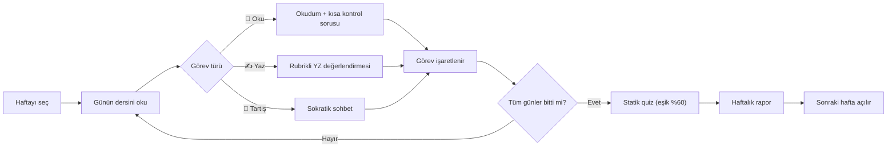
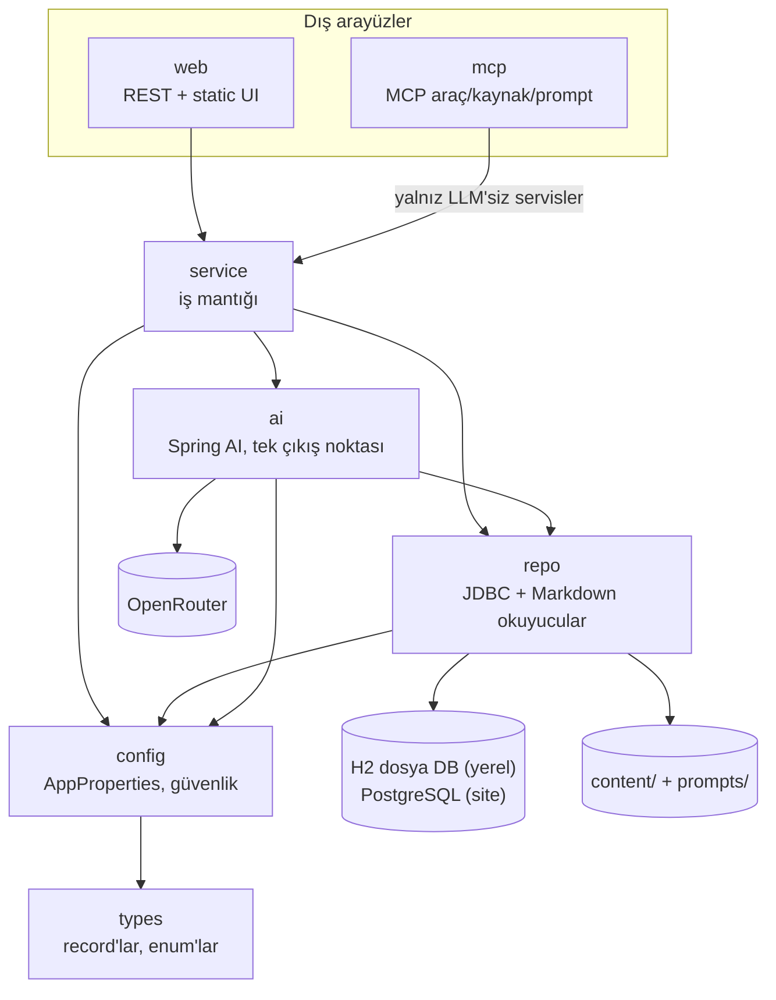
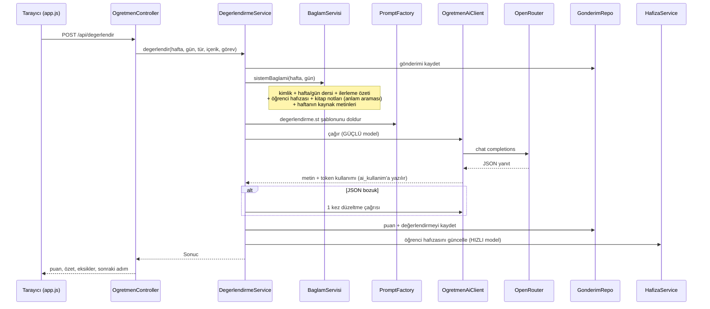

# AI Öğretmen — "AI Çağı Yazılım Mimarlığı" için öğrenme koçu

**AI Öğretmen**, Java geliştiricilerini 12 haftalık **"AI Çağı Yazılım Mimarlığı"** programı
boyunca yönlendiren bir öğrenme uygulamasıdır. Müfredatı
gün gün sunar, ilerlemenizi kaydeder, yazdıklarınızı yapay zekâ (YZ) öğretmene rubrikle
değerlendirtir, takıldığınızda sizi **Sokratik** sorularla cevaba yürütür, hafta sonunda kişisel
bir rapor çıkarır ve sizin hakkınızda öğrendiklerini bir "öğrenci hafızası"nda biriktirir.

Uygulama Spring Boot + Spring AI ile yazılmıştır; yapay zekâ modellerine **OpenRouter**
üzerinden erişir. Tüm arayüz, içerik ve YZ çıktıları **Türkçedir**; teknik terimlerin İngilizcesi
parantez içinde verilir (ör. *bağlam penceresi (context window)*).

Uygulama iki biçimde çalışır; her ikisinde de süreç yalnızca `127.0.0.1` adresine bağlanır:

| Mod | Nasıl açılır | Kimin için |
|---|---|---|
| **Yerel mod** (varsayılan) | profilsiz: `./mvnw spring-boot:run` | **Tek kişi, kendi bilgisayarında.** Giriş yok, kimlik sabit `yerel`, H2 dosya veritabanı. |
| **Site modu** (`site` profili, Faz 10) | `--spring.profiles.active=site` | **Herkese açık, girişsiz eğitim sitesi.** Hesap/kayıt/e-posta yok: ziyaretçi tarayıcısındaki rastgele çerezle tanınır, ilerlemesi sunucuda saklanır ve "ilerleme kodu" ile başka tarayıcıya taşınır. YZ yalnız isteğe bağlı sohbet botu — ziyaretçinin **kendi** OpenRouter anahtarıyla; sunucuda anahtar yok. PostgreSQL, önde nginx/TLS (ADR-0014/0017). |

Aynı içerik, isteğe bağlı bir **MCP sunucusu (Model Context Protocol server)** olarak da
sunulabilir (yalnız yerel kullanım; site moduyla birlikte açılamaz); bu modda sunucu hiçbir YZ
modeli çağırmaz, muhakemeyi bağlanan istemci (ör. Claude Code) yapar.

Program 12 haftadan, her hafta 5 günden oluşur: **60 günlük ders**, **60 statik quiz sorusu**,
**34 Türkçe çalışma metni** ve **8 kategoride 59 alıştırmalı bir Prompt Atölyesi**.

---

## İçindekiler

1. [Özellikler](#özellikler)
2. [Günlük kullanım akışı](#günlük-kullanım-akışı)
3. [Mimari](#mimari)
4. [Teknoloji yığını](#teknoloji-yığını)
5. [Kurulum ve çalıştırma](#kurulum-ve-çalıştırma)
6. [Yapılandırma](#yapılandırma)
7. [Müfredat ve içerik yapısı](#müfredat-ve-içerik-yapısı)
8. [HTTP API uç noktaları](#http-api-uç-noktaları)
9. [MCP sunucusu](#mcp-sunucusu)
10. [YZ sağlayıcısı ve model kademeleme](#yz-sağlayıcısı-ve-model-kademeleme)
11. [Veri, gizlilik ve güvenlik](#veri-gizlilik-ve-güvenlik)
12. [Test ve kalite](#test-ve-kalite)
13. [Proje dizin ağacı](#proje-dizin-ağacı)
14. [Mimari karar kayıtları (ADR)](#mimari-karar-kayıtları-adr)
15. [Katkı rehberi](#katkı-rehberi)
16. [Yol haritası ve bilinen sınırlar](#yol-haritası-ve-bilinen-sınırlar)
17. [Sık sorulan sorular](#sık-sorulan-sorular)
18. [Lisans](#lisans)

---

## Özellikler

### Müfredat: 12 hafta × 5 gün

| Hafta | Konu |
|---|---|
| 1 | Harness Mühendisliği Temelleri |
| 2 | Repo Bilgi Sistemi: AGENTS.md + docs/ |
| 3 | Spec-Driven Akış ve Ajan Yönetimi |
| 4 | Guardrail'lar: Mimari Zorlama + Güvenlik |
| 5 | Mimari Düşünme I: Nitelikler ve Trade-off |
| 6 | Mimari Düşünme II: Stiller ve İletişim |
| 7 | AI Engineering I: Stack, Modeller, Prompt |
| 8 | AI Engineering II: RAG, Fine-tune Kararı, Evaluation |
| 9 | Hexagonal / Clean Mimari (Elle Kirlen) |
| 10 | Mimari Kararları Kolaylaştırmak (Advice Process) |
| 11 | Veri-Yoğun Sistemler (DDIA) |
| 12 | Liderlik, Mentorluk ve Capstone |

- Her haftanın bir **hedefi**, bir **kaynak** satırı ve 5 **gün**ü vardır. Her gün bir ders
  metni ("Bugün ne öğreneceksin?", temel kavramlar, somut örnek, sık yapılan hata) ve sırayla
  yapılan **görevler** içerir. Görev türleri: 📖 Oku, ✍️ Yaz, 💬 Tartış.
- Önerilen ritim günde yaklaşık 20 dakikadır (oku → uygula → sına).
- **Kilit mantığı:** Hafta 1 her zaman açıktır. Sonraki bir hafta, önceki tüm haftaların
  görevleri %100 tamamlanıp quiz'leri **%60 ve üzeri** puanla geçildiğinde açılır. Kilitli
  haftaların içeriği okunabilir (önizleme) ama görev, quiz ve değerlendirme yapılamaz.
- Hafta 1'in önünde kilitsiz bir **Başlangıç Kılavuzu** (diyagramlı program haritası) bulunur.

### Quiz'ler
- **Statik quiz:** Her haftada 5 çoktan seçmeli soru (toplam 60), her biri açıklamalı. Haftanın
  bütün günleri bitince açılır; geçme eşiği %60'tır. Sonuç `quiz_sonuc` tablosuna yazılır.
- **YZ ile yeni sorular:** "AI'dan yeni sorular" düğmesi, haftanın tüm gün içeriklerinden
  statik quiz'de **olmayan** yeni sorular üretir (varsayılan 5, en fazla 10 soru; hızlı model).

### YZ öğretmenle değerlendirme
- ✍️ Yaz görevlerinde cevabınızı gönderdiğinizde güçlü model, sabit bir rubrikle 100 üzerinden
  puanlar: **kavram doğruluğu 40, uygulanabilirlik 30, derinlik/bağ kurma 20, ifade netliği 10**.
- Çıktı yapılandırılmış JSON'dur: puan, tek cümlelik özet, doğru noktalar, eksikler, yanlış
  anlamalar (ne / doğrusu / neden önemli), yarınki somut adım ve tekrar önerisi.
- Model geçerli JSON döndürmezse **bir kez düzeltme çağrısı** yapılır; yine bozuksa ham metin
  gösterilir (uygulama çökmez).
- Aynı ekranda **🔍 Soruyu aç** (görevi sade Türkçeyle açar, cevap vermez) ve
  **💡 Örnek cevap göster** (ilham verecek somut bir taslak üretir) yardımcıları vardır.

### Sokratik sohbet
- Sağ paneldeki **AI Öğretmen** doğrudan cevap vermek yerine yönlendirici sorular sorar (mesaj
  başına en fazla 1 soru).
- Sohbet geçmişi hafta bazında veritabanında tutulur; her çağrıda son **20 mesaj** bağlama eklenir.
- Sohbet panelinin üstündeki görev barı o anda yapılması gereken görevi ve "→ göreve geç"
  kısayolunu gösterir.

### Türkçe çalışma metinleri (kaynaklar)
- `content/kaynaklar/` altında **34** Markdown metin vardır: İngilizce kaynakların Türkçe çalışma
  metinleri ve temel tazeleme metinleri (SOLID, tasarım kalıpları, clean code, güvenli kodlama,
  geliştirici testi), MCP adaptörü, LLM uygulama güvenliği, FinOps/token ekonomisi, değerlendirme
  (evals) ve gözlemlenebilirlik gibi konular.
- Metinler arayüzde sayfa içinde açılır; ` ```svg ` çitli **satır içi diyagramlar** okuma
  sayfasında çizilir.
- Her metnin `etiketler` alanı ilgili hafta numaralarını taşır; aktif haftayla eşleşen metinler
  YZ'nin sistem bağlamına (SVG'leri ayıklanmış olarak) eklenir.

### Prompt Atölyesi
- Sol menüde, haftalardan bağımsız ve **kilitsiz** bir laboratuvar: prompt (istem) yazma
  tekniklerini deneyerek öğrenme.
- 8 kategori: Temel Yapı, Muhakeme, Yapılandırma, Kısıtlama & Kontrol, Yazılım-Özel,
  İleri / Ajansal, Bağlam Mühendisliği, Anti-Pattern'ler — toplam **59 alıştırma**.
- Her alıştırma: teknik, görev, (varsa) kötü örnek, ipucu, ideal çözüm ve gerekçe. "İdeal çözümü
  göster" tamamen istemci tarafında çalışır (**token harcamaz**). "AI Öğretmen değerlendirsin"
  düğmesi, yazdığınız prompt'u ideal çözümle kıyaslayıp rubrikle değerlendirir (API anahtarı gerekir).

### İlerleme takibi
- Görev tamamlanma durumu, gün kartlarındaki sayaç (ör. "1/3"), sol menüdeki hafta yüzdesi ve
  son quiz puanı.
- YZ etkinken görevler YZ öğretmenle üzerinden geçilerek tamamlanır (Okudum → kısa cevap,
  yazıyı değerlendirt, tartış); YZ kapalıyken kutucuklar elle işaretlenebilir.

### Öğrenci hafızası
- YZ öğretmen, etkileşimlerden çıkardığı gözlemleri Markdown dosyalarına yazar ve bunlar sonraki
  tüm YZ çağrılarına bağlam olarak eklenir:
  - `data/hafiza/OGRENCI.md` — genel öğrenci profili
  - `data/hafiza/hafta-NN/notlar.md` — hafta bazlı gözlemler
- Hafıza; değerlendirmelerden sonra ve sohbette her 4 kullanıcı mesajında bir, **hızlı model** ile
  güncellenir. Güncelleme hataları ana akışı bozmaz; dosyalar "yaz → yeniden adlandır" ile atomik
  yazılır.
- Site modunda her ziyaretçinin hafızası ayrı dizindedir
  (`data/hafiza/kullanicilar/<sha256("z-<ilerleme-kodu>")>/…`); bir kişinin hafızası başkasının
  prompt'una girmez. Sitede hafıza, sohbetin her 4 mesajında bir **aynı isteğin ziyaretçi anahtarıyla**
  güncellenir (değerlendirme sitede yok).

### Haftalık rapor
- "Haftalık Rapor" düğmesi, haftanın tüm verisini güçlü modele verip kişisel bir Markdown rapor
  üretir (nerede olduğunuz, neyi tekrar etmeniz gerektiği).
- Rapor `data/raporlar/hafta-NN.md` olarak önbelleğe alınır; "Yenile" ile (POST) yeniden üretilir.
- **Yalnız yerel modda.** Sitede rapor uçları kayıtlı değildir (404) ve düğme görünmez (ADR-0017).

### Kitap notları ve anlam-eşleşmeli bağlam (RAG)
- Okuduğunuz kitaplardan ham not ya da **sayfa fotoğrafı** gönderebilirsiniz. Fotoğraftan metin,
  görüntü destekli güçlü modelle çıkarılır (JPEG, PNG, WebP, GIF; en fazla 10 MB).
- Not, hızlı modelle özet + hafta etiketleri + anahtar kavramlara dönüştürülür ve
  `data/hafiza/kitaplar/<slug>.md` dosyasında birikir.
- Notlar oluşturuldukları anda **gömülür (embedding)** ve bellek içi bir vektör deposuna eklenir
  (`data/hafiza/vektor.json`). YZ bağlamına notlar hafta etiketine göre değil **anlam
  benzerliğine** göre seçilir: son sohbet mesajı varsa ona, yoksa aktif ders metnine göre arama
  yapılır. Depo boşsa, anahtar yoksa veya embedding hatası olursa hafta-etiketi eşleşmesine düşülür.
- Not: Bu özellik şu an **yalnızca API üzerinden** kullanılır; arayüzde ayrı bir düğmesi yoktur
  (bkz. [API](#http-api-uç-noktaları)).
- **Yalnız yerel modda.** Kitap notları ve vektör deposu kullanıcıya ayrılmamış, ortak veridir; bu
  yüzden site modunda kitap uçları 404 döner, vektör deposu yüklenmez ve prompt'lara kitap bağlamı
  eklenmez.

### YZ kullanım takibi
- Her YZ çağrısının girdi/çıktı token sayısı, çağıran kullanıcıyla birlikte `ai_kullanim`
  tablosuna yazılır; `/api/kullanim` yalnız o kullanıcının satırlarını toplar. Sitede kota yoktur;
  maliyet ziyaretçinin kendi anahtarına yazılır, sayaç yalnız görünürlük içindir (anahtar yazılmaz).
- Aynı satır çağrının süresini (`sure_ms`, milisaniye; Spring AI'nın yeniden denemeleri dahil toplam
  bekleme) ve sağlayıcının cevapta bildirdiği modeli (`yanit_model`) de tutar. `model` istenen modeldir;
  OpenRouter başka bir sağlayıcıya/yedeğe geçtiyse `yanit_model` farklı görünür (ADR-0016). Bu iki sütun
  yalnız ham kayıttır — `/api/kullanim` bunları özetlemez; eski satırlarda boştur. Başarısız çağrı
  satır yazmaz.
- `GET /api/kullanim` toplam çağrı sayısını, toplam girdi/çıktı token'ı ve işlem bazında dağılımı
  (değerlendirme, sohbet, quiz, kitap, hafıza, örnek, açıklama, rapor) döndürür; ayrıca YZ'nin
  etkin olup olmadığını (`aiAktif`) bildirir. Para birimi cinsinden maliyet hesaplanmaz;
  harcamayı OpenRouter panelinden izleyebilirsiniz.

### Temiz başlangıç (sıfırlama)
- Arayüzdeki sıfırlama düğmesi (onay ister) görev ilerlemesini, gönderimleri, quiz sonuçlarını,
  sohbet geçmişini, YZ'nin yazdığı öğrenci hafızasını ve haftalık rapor önbelleğini siler — yalnız
  **aktif kullanıcının** verisini.
- **Korunanlar:** kitap notları, vektör deposu, dersler, müfredat ve (site modunda) ziyaretçi kimliği
  (ilerleme kodu aynı kalır).

### MCP sunucusu
- Aynı müfredat, kaynaklar, atölye ve ilerleme işlemleri **8 araç, kaynaklar (resources) ve 5
  prompt** olarak MCP üzerinden sunulabilir. Ayrıntı: [MCP sunucusu](#mcp-sunucusu).
- Site profiliyle birlikte açılamaz: `site` + (`mcp` | `mcp-http` | `spring.ai.mcp.server.enabled=true`)
  açılışta hata verir.

### Mülakat modülü (varsayılan kapalı)
- Kod tabanında bir mülakat hazırlık modülü de bulunur; **varsayılan olarak kapalıdır**
  (ADR-0011). Kapalıyken ilgili bileşenler hiç oluşturulmaz, `/api/mulakat/**` uçları 404 döner ve
  arayüzde görünmez. Açmak için: `APP_MULAKAT_ETKIN=true` (yalnız yerel modda; site modunda bu
  bayrak etkisizdir, modül her zaman kapalıdır).

### Ziyaretçi kimliği, ilerleme kodu ve kendi anahtarın (yalnız site modu)
Site modunda (`site` profili, ADR-0017) uygulama herkese açık bir eğitim sitesi gibi çalışır;
**giriş, kayıt, şifre, e-posta yoktur**:

- **Ziyaretçi çerezi:** ilk istekte tarayıcıya rastgele bir kimlik yazılır — `aio_ziyaretci` çerezi
  (22 karakter, 128 bit `SecureRandom`; `HttpOnly`, `SameSite=Lax`, `Secure`; 365 gün, ziyarette
  yenilenir). Veritabanında `kullanici_id` = `z-<kimlik>`. Biçimi geçersiz çerez yok sayılır, yenisi
  üretilir. Ziyaretçi kaydı (`ziyaretci` tablosu) **yalnız ilk yazmada** açılır; sadece bakıp çıkan
  iz bırakmaz.
- **İlerleme kodu:** üst bardaki "İlerleme kodum" kimliği gösterir (kopyala düğmesiyle). Başka bir
  tarayıcıda "Geri yükle"ye yapıştırınca o tarayıcı aynı ilerlemeye geçer (oradaki önceki ilerleme
  birleştirilmez, üzerine geçilir — onay istenir). Kod **şifre gibidir**: bilen ilerlemeyi görür.
  Henüz hiçbir şey işaretlememiş birinin kodu geri yüklenemez (422).
- **Sohbet botu isteğe bağlı, kendi anahtarınla:** sohbet panelindeki kart ziyaretçiden kendi
  OpenRouter anahtarını ister ("Bu cihazda hatırla" → `localStorage`, değilse `sessionStorage`;
  Türkçe "anahtarı nasıl alırım" yardımı, harcama limiti koyma önerisiyle). Anahtar **yalnız**
  `POST /api/sohbet` isteğine `X-OpenRouter-Anahtar` başlığıyla eklenir; sunucu onu o istekte
  kullanıp unutur — veritabanına, loga, hafıza dosyasına, hata mesajına yazılmaz. Sunucuda
  OpenRouter anahtarı yoktur; `OPENROUTER_API_KEY` verilse bile sitede okunmaz. Maliyet ziyaretçinin
  kendi hesabına yazılır.
- **Görevler:** anahtarı olmayan ziyaretçi görevleri **kendisi işaretler** ("Okudum ✓", "Yaptım ✓",
  "Tartıştım ✓"); anahtarı olan oku ve tartış görevlerini isterse YZ öğretmenle geçer. Yaz görevi
  sitede herkes için "Yaptım ✓" ile biter (YZ değerlendirmesi sitede yok). Sıra/kilit mantığı aynıdır.
- **Herkes yalnız kendi verisini görür:** görev ilerlemesi, gönderimler, quiz sonuçları, sohbet,
  YZ kullanım sayacı ve öğrenci hafızası (ziyaretçi başına dizin). Yönetici paneli ve sıralama
  tablosu **yoktur**.
- **Sitede kapalı olanlar:** sohbet dışındaki bütün YZ özellikleri (değerlendirme, örnek cevap,
  açıklama, YZ quiz, haftalık rapor, prompt atölyesi değerlendirmesi), kitap notları ve
  anlam-eşleşmeli kitap bağlamı (vektör deposu), MCP sunucusu ve mülakat modülü. Uçları kayıtlı
  değildir (404), arayüzde görünmezler. Statik quiz, dersler, kaynaklar, ilerleme ve sohbet çalışır.
- **Kötüye kullanım sınırları:** yazan istekler IP başına 60/dk, sohbet ziyaretçi başına 20/dk,
  ilerleme kodu geri yükleme IP başına 10/saat, yeni ziyaretçi IP başına 20/saat (aşımda 429; sayaçlar
  bellekte).
- **180 gün temizliği:** her gece 03:30'da 180 gündür gelmeyen ziyaretçinin bütün verisi silinir.
- Ziyaretçi verisini kendisi "🔄 Sıfırla" ile silebilir; tamamen silinmesi için işletmen ilerleme
  koduyla siler ([docs/kurulum-site.md](docs/kurulum-site.md) §7.3).

---

## Günlük kullanım akışı

Uygulamanın kendi "Nasıl kullanılır?" kılavuzundaki akış:

1. **Haftayı seç, günün dersini oku.** Sol menüden haftayı, ortadaki panelden gün kartını açın.
   "📚 Bu haftanın kaynakları" kutusu ilgili Türkçe çalışma metinlerini sayfa içinde açar.
2. **Görevleri sırayla yap.** Bir görev bitmeden sonraki açılmaz.
   - *📖 Oku:* Metni okuyun, "✓ Okudum"a basın; YZ öğretmen kısa bir kontrol sorusu sorar.
   - *✍️ Yaz:* Çalışma alanında cevabınızı yazın, "Cevabımı AI öğretmene değerlendirt"e basın.
     Puan, doğru noktalar, eksikler ve sonraki adım gelir; görev otomatik işaretlenir.
   - *💬 Tartış:* Sohbet panelinde öğretmenle konuyu tartışın.
3. **Takıldığında sohbette sor.** Öğretmen hazır cevap vermez, sorularla yönlendirir ve sizi hatırlar.
4. **Haftayı kapat: quiz + rapor.** Tüm günler bitince statik quiz açılır (%60 eşik). İsterseniz YZ'den
   yeni sorular alın, sonra haftalık raporu isteyin. Quiz'i geçince sonraki hafta açılır.



---

## Mimari

### Katman yönü

Kod, tek yönlü bir katman düzenine uyar ve bu düzen **ArchUnit** testleriyle derleme/test
aşamasında zorlanır (kural ihlali = kırmızı build):

```
types → config → repo → service → ai → web
                                   └──→ mcp
```

| Katman | Paket (`tr.velzon.aiogretmen.…`) | İçerik | Kimler erişebilir |
|---|---|---|---|
| Types | `types` | `record`'lar, enum'lar, istisnalar (ör. `HaftaDetay`, `QuizSorusu`, `Degerlendirme`) | config, repo, service, ai, web, mcp |
| Config | `config` | `AppProperties`, `SiteAyarlari`, kullanıcı bağlamı, güvenlik yapılandırmaları, `CalismaModu`, `@LlmKullanan`, `@MulakatEtkin` | repo, service, ai, web, mcp |
| Repo | `repo` | Veritabanı erişimi (Spring Data JDBC; yerelde H2, sitede PostgreSQL) + Markdown içerik okuyucuları (`ContentRepo`, `KaynakRepo`, `AtolyeRepo`) | service, ai |
| Service | `service` | İş mantığı: müfredat, ilerleme, değerlendirme, sohbet, quiz, rapor, hafıza, kitap, atölye, sıfırlama; site modunda ziyaretçi kaydı, temizlik ve hız sınırı | web, mcp |
| AI | `ai` | Spring AI `ChatClient`/embedding entegrasyonu — **tek çıkış noktası** | service |
| Web | `web` | REST controller'lar, CSRF filtresi, hata yönetimi + `static/` arayüz | (hiçbiri) |
| MCP | `mcp` | MCP araç/kaynak/prompt adaptörleri | (hiçbiri) |

**Neden?** YZ çağrılarını tek pakete hapsetmek, hızlı değişen Spring AI API'sinin yüzeyini
daraltır ve sağlayıcı değişikliğini (ör. Anthropic → OpenRouter geçişi, ADR-0004) yalnız `ai/` ve
yapılandırmayla sınırlar. `web` katmanı `repo` veya `ai`'ya doğrudan erişemez; her şey `service`
üzerinden geçer.

ArchUnit kuralları (`src/test/java/tr/velzon/aiogretmen/MimariTestleri.java`):

| Kural | Ne zorlar |
|---|---|
| `katman_kurali` | Yukarıdaki katman erişim matrisi |
| `dongusuz` | Paketler arasında döngüsel bağımlılık yok |
| `claude_yalniz_ai_paketinden` | Spring AI (`org.springframework.ai..`) yalnız `ai` paketinden kullanılabilir |
| `mcp_llmsiz` | `mcp` paketi `@LlmKullanan` ile işaretli (token harcayan) servislere bağımlı olamaz (ADR-0009) |
| `types_bagimsiz` | `types` hiçbir katmana bağımlı değildir |



### Çalışma modları ve kimlik (yerel / site)

Kimlik, servislere `config/KullaniciBaglami` arayüzü üzerinden gelir; hangi gerçeklemenin
kullanılacağını Spring profili seçer. Servisler profil bilmez, yalnız "aktif kullanıcı kim?" diye sorar.

| Profil | `KullaniciBaglami` | Güvenlik zinciri | Veritabanı |
|---|---|---|---|
| (yok) / `mcp` | `YerelKullaniciBaglami` — sabit `yerel` | `VarsayilanGuvenlikYapilandirma` (her şey açık; koruma `CsrfKoruma` filtresinde) | H2 dosya |
| `mcp-http` | `JwtKullaniciBaglami` — JWT'deki `email` / `sub` | `McpHttpGuvenlikYapilandirma` (OAuth 2.1 kaynak sunucusu) | H2 dosya |
| `site` | `ZiyaretciKullaniciBaglami` — `aio_ziyaretci` çerezinden `z-<kimlik>`; kimlik yoksa **hata** (asla `yerel`e düşmez) | `SiteGuvenlikYapilandirma` (girişsiz, oturumsuz + ziyaretçi çerezi + CSRF token) | PostgreSQL (yalnız ortam değişkeninden) |

**`site` güvenlik zinciri (`config/SiteGuvenlikYapilandirma`):**
- **Kimlik doğrulama yok, oturum yok** (stateless; `JSESSIONID` oluşmaz). `config/ZiyaretciCerezi`
  filtresi her isteğe `aio_ziyaretci` çerezinden kimlik koyar; çerez yoksa ya da biçimi geçersizse
  yenisini üretip yazar. Bütün sayfalar ve `/api/**` herkese açıktır; veri uçları yalnız o
  ziyaretçinin verisini okur/yazar.
- **CSRF token açık** (kimlik çerezle taşındığı için): `CookieCsrfTokenRepository` → `XSRF-TOKEN`
  çerezi; ön yüz durum değiştiren isteklere `X-XSRF-TOKEN` başlığı ekler. `web/CsrfKoruma`
  (Origin / Sec-Fetch-Site) ek katman olarak çalışmaya devam eder.
- `web/HizSiniriInterceptor` IP/ziyaretçi hız sınırlarını, `web/ZiyaretciDokunmaInterceptor` ilk
  yazmada ziyaretçi kaydını ve en çok günde bir `son_gorulme` güncellemesini yapar.
- Sohbet: `config/BaslikAiAnahtarBaglami` `X-OpenRouter-Anahtar` başlığını okur ve biçimini denetler
  (`sk-or-` + 10–200 karakter); `ai/ZiyaretciChatModelKaynagi` her istekte o anahtarla bir model kurar
  (anahtar başına önbellek yok). Başlık yoksa 400 `neden: ANAHTAR_GEREKLI`, biçimsizse 400
  `neden: ANAHTAR_BICIMI`; YZ çağrılmaz, sunucu anahtarına düşülmez.
- Açılış denetimleri: `site` + MCP birlikte açılmaz; `config/SiteVeritabaniDenetimi`
  `SPRING_DATASOURCE_URL` yoksa uygulamayı anlaşılır mesajla durdurur.

**`config/CalismaModu`:** "site mi, yerel mi?" sorusunun tek cevabı. Sitede ortak (kullanıcıya
ayrılmamış) modülleri kapatmak için kullanılır: `ai/AiYapilandirma` vektör deposunu hiç kurmaz
(`AnlamArama` boş çalışır), `service/BaglamServisi` prompt'a kitap bağlamı eklemez. Böylece profil
kontrolü servislere dağılmaz.

**`service/KisiselDizin`:** dosya tabanlı kişisel veri (öğrenci hafızası, rapor önbelleği) için
kullanıcı dizinini çözer. `yerel` kullanıcı kökün kendisini kullanır (eski veri taşınmaz); diğer
kimlikler `<kök>/kullanicilar/<sha256-hex(kimlik)>/` dizinine gider. Dizin adı sabit 64 hex karakter
olduğundan yol geçişi (`../`) yapısal olarak imkânsızdır ve kimlik (JWT e-postası ya da ilerleme kodu)
diskte düz görünmez.

**`config/JdbcAdlandirma`:** Spring Data JDBC'nin tablo adlarını tırnaklamasını kapatır; böylece
aynı eşleme H2 (büyük harfe katlar) ve PostgreSQL'de (küçük harfe katlar) çalışır (ADR-0014).

### Örnek istek akışı: bir yazma görevinin değerlendirilmesi



### Paket paket önemli sınıflar

| Paket | Önemli sınıflar | Görev |
|---|---|---|
| `ai` | `OgretmenAiClient` (arayüz), `SpringAiOgretmenClient`, `ZiyaretciChatModelKaynagi` (site), `AiYapilandirma`, `PromptFactory`, `JsonCevapParser`, `AnlamArama`, `SpringAiAnlamArama` | Sohbet ve embedding çağrıları, prompt şablonlarını doldurma, JSON çıktıyı ayrıştırma, vektör araması. Anahtar yoksa istemci "devre dışı" çalışır. |
| `config` | `AppProperties`, `SiteAyarlari`, `CalismaModu`, `KullaniciBaglami`, `YerelKullaniciBaglami`, `JwtKullaniciBaglami`, `ZiyaretciKullaniciBaglami`, `ZiyaretciCerezi`, `BaslikAiAnahtarBaglami`, `VarsayilanGuvenlikYapilandirma`, `McpHttpGuvenlikYapilandirma`, `SiteGuvenlikYapilandirma`, `SiteVeritabaniDenetimi`, `JdbcAdlandirma`, `LlmKullanan`, `MulakatEtkin` | Özellikler, çalışma modu, kullanıcı kimliği (profil bazlı), güvenlik zincirleri, site açılış denetimleri, işaretleyici anotasyonlar |
| `repo` | `ContentRepo`, `KaynakRepo`, `AtolyeRepo`, `IlerlemeRepo`, `GonderimRepo`, `QuizSonucRepo`, `SohbetRepo`, `KullanimRepo`, `KullanimSorgulari`, `ZiyaretciRepo` | Markdown içeriği açılışta belleğe yükleme; veritabanı erişimi (sitede ziyaretçi kaydı dahil) |
| `service` | `MufredatService`, `IlerlemeService`, `DegerlendirmeService`, `SohbetService`, `QuizUretimService`, `RaporService`, `HafizaService`, `KitapService`, `KaynakService`, `AtolyeService`, `OrnekService`, `BaglamServisi`, `BaglamKirpici`, `KullanimService`, `SifirlamaService`, `McpPromptServisi`, `KisiselDizin` | İş mantığı, YZ bağlamının kurulması, kullanıcı başına dosya dizini |
| `service` (site) | `ZiyaretciService`, `ZiyaretciTemizlikService`, `HizSiniri` | Ziyaretçi kaydı ve ilerleme kodu geri yükleme, 180 gün temizliği (gece 03:30), bellek içi hız sınırı sayaçları |
| `web` | `ProgramController`, `OgretmenController`, `AtolyeController`, `KitapController` (yalnız yerel), `OzellikController`, `ZiyaretciController` (yalnız site), `HizSiniriInterceptor` (yalnız site), `CsrfKoruma`, `HataYonetimi` | HTTP uçları, siteler arası istek koruması, hata → HTTP durum eşlemesi |
| `mcp` | `OgretmenMcpAraclari`, `OgretmenMcpKaynaklari`, `OgretmenMcpPromptlari`, `McpKullaniciKimligi`, `McpAdaptorDestek` | MCP primitifleri (MCP Java SDK tipleriyle; Spring AI import edilmez) |

---

## Teknoloji yığını

Sürümler `pom.xml`'den alınmıştır.

| Bileşen | Sürüm / not |
|---|---|
| Java | 17 (`java.version`) |
| Spring Boot | 3.5.16 (`spring-boot-starter-parent`) |
| Spring AI | 1.1.8 (BOM) — `spring-ai-starter-model-openai` (OpenRouter'ın OpenAI-uyumlu API'si), `spring-ai-vector-store` (`SimpleVectorStore`) |
| MCP | `spring-ai-starter-mcp-server` (stdio) + `spring-ai-starter-mcp-server-webmvc` (streamable-HTTP) |
| Güvenlik | `spring-boot-starter-security` (yerel modda açık zincir, site modunda girişsiz + CSRF token), `spring-boot-starter-oauth2-resource-server`, `org.springaicommunity:mcp-server-security` 0.0.6 (MCP HTTP) |
| Veri erişimi | `spring-boot-starter-data-jdbc` + H2 (yerel/MCP modları, dosya tabanlı) + `org.postgresql:postgresql` (`runtime`, site modu — ADR-0014; sürüm Spring Boot parent'tan) |
| Markdown | `commonmark` 0.24.0 + `commonmark-ext-gfm-tables` 0.24.0 (tablo desteği, ADR-0006) |
| Test | `spring-boot-starter-test`, `spring-security-test`, ArchUnit (`archunit-junit5` 1.4.2) |
| Derleme | Maven Wrapper (`./mvnw`) |
| Arayüz | Bağımlılıksız HTML/CSS/JavaScript (`src/main/resources/static/`), CSP: `default-src 'self'` (satır içi betik/stil yok) |
| Site dağıtımı | systemd + nginx (TLS, certbot) — Docker yok; şablonlar `deploy/` altında |
| Müfredat üretici | Node.js betiği (`tools/html-to-content.mjs`) |

Varsayılan modeller (OpenRouter kimlikleri): `anthropic/claude-sonnet-4.6` (güçlü),
`anthropic/claude-haiku-4.5` (hızlı), `google/gemini-embedding-001` (embedding).

---

## Kurulum ve çalıştırma

### Gereksinimler
- **Java 17 veya üzeri** (JDK). Maven kurmanız gerekmez; depo Maven Wrapper (`./mvnw`) içerir.
- **Git**.
- **Node.js** — yalnızca müfredatı HTML kaynağından yeniden üretmek isterseniz (bkz.
  [Müfredat ve içerik yapısı](#müfredat-ve-içerik-yapısı)); uygulamayı çalıştırmak için gerekmez.
- YZ özellikleri için bir **OpenRouter API anahtarı** (isteğe bağlı).

### 1. Depoyu klonlayın
```bash
git clone https://github.com/pera-soft/ai-engineering.git
cd ai-engineering
```

### 2. Derleyin ve testleri çalıştırın
```bash
./mvnw verify
```

### 3a. Anahtarla çalıştırma (önerilen yol: `baslat.sh`)
```bash
cp .env.ornek .env
# .env içindeki OPENROUTER_API_KEY satırına kendi anahtarınızı yazın
./baslat.sh
```
`baslat.sh`, `.env` dosyasını okur; dosya yoksa ya da anahtar hâlâ örnek değerdeyse hata
verip durur, aksi halde `./mvnw spring-boot:run` çalıştırır. `.env` git dışındadır (`.gitignore`).

### 3b. Ortam değişkeniyle doğrudan çalıştırma
```bash
OPENROUTER_API_KEY=... ./mvnw spring-boot:run
```

### 3c. Anahtarsız çalıştırma
```bash
./mvnw spring-boot:run
```
Uygulama anahtarsız da açılır. Bu durumda:

| Çalışır | Çalışmaz (HTTP 503 döner / arayüzde gizlenir) |
|---|---|
| Müfredat, dersler, kaynak metinleri | Yazma değerlendirmesi, Sokratik sohbet |
| Görevleri elle işaretleme, ilerleme | "Soruyu aç" / "Örnek cevap göster" |
| Statik quiz | YZ ile quiz üretimi |
| Prompt Atölyesi (ideal çözümü gösterme) | Atölyede YZ değerlendirmesi |
| Sıfırlama, kullanım ekranı | Haftalık rapor, kitap notu işleme, anlam araması |
| MCP sunucusu (tamamen) | — |

### 4. Tarayıcıda açın
**http://127.0.0.1:8090**

### Mülakat modülünü açmak (isteğe bağlı)
```bash
APP_MULAKAT_ETKIN=true OPENROUTER_API_KEY=... ./mvnw spring-boot:run
```

### Neden yalnız 127.0.0.1?
Yerel modda uygulama kimlik doğrulaması olmayan, tek kişilik bir araçtır ve YZ çağrıları sizin
anahtarınızla yapılır. Ağa açılsaydı herkes anahtarınızla model kullanabilir ve verinizi görebilirdi.
Bu yüzden `server.address: 127.0.0.1` sabittir ve proje kuralı gereği başka bir adrese bağlanmaz —
site modunda bile; orada dışarıya yalnız önündeki nginx/TLS açılır. Üstelik
`127.0.0.1`'e bağlanmak tek başına yeterli değildir: tarayıcınızdaki başka bir sitenin yerel
sunucuya istek atmasını önlemek için ayrıca bir CSRF filtresi vardır (bkz.
[Veri, gizlilik ve güvenlik](#veri-gizlilik-ve-güvenlik)).

### Portlar

| Mod | Adres |
|---|---|
| Web arayüzü (varsayılan) | `127.0.0.1:8090` |
| MCP streamable-HTTP (`mcp-http` profili) | `127.0.0.1:8091`, uç nokta `/mcp` |
| MCP stdio (`mcp` profili) | Ağ portu yok; stdin/stdout |
| Site (`site` profili) | Uygulama `127.0.0.1:8090`; dışarıya nginx `443` (+ `80` → https yönlendirmesi) |

### Girişsiz site (sunucu)
Aynı uygulama `site` profiliyle herkese açık, girişsiz bir eğitim sitesi olarak çalışır
(ADR-0017, ADR-0014). Varsayılan (profilsiz) yerel mod bundan etkilenmez.

```
tarayıcı ──https──▶ nginx (443, TLS) ──http──▶ uygulama 127.0.0.1:8090 (systemd, Java 17, tek örnek)
                                                   ├──▶ PostgreSQL 127.0.0.1:5432
                                                   └──▶ OpenRouter (YALNIZ sohbet; ziyaretçinin kendi anahtarıyla)
```

Adım adım kurulum, güncelleme, yedekleme/geri yükleme, ziyaretçi verisi silme ve sorun giderme
**[docs/kurulum-site.md](docs/kurulum-site.md)** kılavuzundadır. Özetle:

1. **Önkoşullar:** Java 17 JRE, PostgreSQL 14+, nginx, certbot, alan adı için DNS kaydı
   (örnek: `egitim.ornek.com`). OpenRouter anahtarı ve SMTP hesabı **gerekmez**. Güvenlik duvarında
   dışarıya yalnız 80/443 (+ SSH) açık; 8090 ve 5432 kapalı kalır.
2. **Sistem kullanıcısı ve dizinler:** `/opt/ai-ogretmen/` (jar, `content/`, `prompts/` salt okunur;
   yazılabilir tek yer `data/`), ortam değişkenleri `/etc/ai-ogretmen/site.env`.
3. **PostgreSQL:** `deploy/postgres-kurulum.sql.ornek` ile süper kullanıcı olmayan `ai_ogretmen` rolü ve
   veritabanı. Tablolar uygulamanın ilk açılışında `schema.sql` ile kurulur (idempotent; göç aracı yok).
4. **Derle ve kopyala:** `./mvnw -DskipTests package` → jar + `content/` + `prompts/` sunucuya.
5. **Ortam değişkenleri:** `deploy/site.env.ornek` → `/etc/ai-ogretmen/site.env` (izin `0640`);
   `SPRING_DATASOURCE_*` ve `APP_SITE_IZINLI_ORIGINLER` doldurulur. Zorunlu değerler eksikse uygulama
   **açılmaz** ve nedenini loga yazar.
6. **systemd:** `deploy/ai-ogretmen-site.service` (`-Dspring.profiles.active=site`, sertleştirilmiş birim;
   **tek örnek** — hız sınırları bellekte, gece temizliği kilitsiz).
7. **nginx + TLS:** `deploy/nginx-site.conf.ornek` (http → https, HSTS, `X-Forwarded-*` başlıkları,
   180 sn okuma zaman aşımı) + certbot sertifikası.
8. **Sağlık kontrolü:** kök adres 200; `aio_ziyaretci` ve `XSRF-TOKEN` çerezleri `Secure`;
   `/api/ozellikler` → `{"mulakat":false,"site":true,"sunucuAi":false}`; bir görevi işaretle → ilerleme
   kodunu başka tarayıcıda geri yükle.

> Durum: kod, testler ve dağıtım paketi hazır (Faz 10). `SitePostgresEntegrasyonTest` dağıtımdan önce bir
> kez gerçek PostgreSQL'e karşı koşulmalı (bkz. [Test ve kalite](#test-ve-kalite)).

#### Site modunu yerelde denemek (PostgreSQL olmadan)
```bash
SPRING_DATASOURCE_URL='jdbc:h2:file:./data/site-deneme' \
APP_SITE_GUVENLI_CEREZ=false \
./mvnw spring-boot:run -Dspring-boot.run.profiles=site
```
- `SPRING_DATASOURCE_URL` **açıkça** verilmelidir; site profili veritabanı adresine varsayılan
  koymaz (canlı sessizce H2'ye düşmesin). Yerel moddan ayrı bir H2 dosyası kullanılır.
- `APP_SITE_GUVENLI_CEREZ=false` → çerezler `Secure` olmaz; aksi halde tarayıcı http üzerinden
  ziyaretçi çerezini geri göndermez ve her istekte yeni ziyaretçi sayılırsınız.
- OpenRouter anahtarı sunucuya verilmez. Sonra **http://127.0.0.1:8090** → görevleri kendin işaretle;
  sohbeti denemek için kendi OpenRouter anahtarını sohbet paneline yapıştır.

---

## Yapılandırma

Ana yapılandırma `src/main/resources/application.yml` dosyasındadır. Spring Boot'un esnek
bağlama kuralı sayesinde her özellik bir ortam değişkeniyle geçersiz kılınabilir
(ör. `app.ai.model.guclu` → `APP_AI_MODEL_GUCLU`).

### Uygulama özellikleri

| Özellik | Varsayılan | Açıklama |
|---|---|---|
| `server.port` | `8090` | Web arayüzü portu |
| `server.address` | `127.0.0.1` | Bağlanılan adres (değiştirmeyin) |
| `spring.ai.openai.api-key` | `${OPENROUTER_API_KEY:}` | OpenRouter anahtarı; boşsa YZ uçları 503 döner, uygulama çalışır |
| `spring.ai.openai.base-url` | `https://openrouter.ai/api` | OpenRouter'ın OpenAI-uyumlu API kökü |
| `spring.datasource.url` | `jdbc:h2:file:./data/ogrenme;AUTO_SERVER=FALSE` | H2 dosya veritabanı (`data/ogrenme.mv.db`); `site` profilinde varsayılan yoktur, `SPRING_DATASOURCE_URL` zorunludur |
| `spring.sql.init.mode` | `always` | `schema.sql` her açılışta çalışır (idempotent) |
| `spring.servlet.multipart.max-file-size` | `10MB` | Kitap sayfası fotoğrafı üst sınırı |
| `spring.servlet.multipart.max-request-size` | `12MB` | Çok parçalı istek üst sınırı |
| `app.content-dir` | `./content` | Müfredat ve içerik kökü |
| `app.prompt-dir` | `./prompts` | Prompt şablonları |
| `app.hafiza-dir` | `./data/hafiza` | Öğrenci hafızası ve kitap notları |
| `app.rapor-dir` | `./data/raporlar` | Haftalık rapor önbelleği |
| `app.vektor-dosyasi` | `./data/hafiza/vektor.json` | Vektör deposunun JSON dosyası |
| `app.ai.model.guclu` | `anthropic/claude-sonnet-4.6` | Değerlendirme, sohbet, rapor, görüntüden metin |
| `app.ai.model.hizli` | `anthropic/claude-haiku-4.5` | Quiz üretimi, hafıza, kitap notu, örnek/açıklama |
| `app.ai.model.embedding` | `google/gemini-embedding-001` | Anlam-eşleşmeli bağlam için embedding |
| `app.mulakat.etkin` | `false` | Mülakat modülü (ADR-0011) |
| `spring.ai.mcp.server.enabled` | `false` | Web profilinde MCP kapalı; MCP profillerinde açılır |

> Yollar göreli olduğundan uygulamayı **depo kökünden** çalıştırın.

> Portu değiştirebilirsiniz (ör. `SERVER_PORT=9000`). CSRF filtresi (`web/CsrfKoruma`) izinli
> `Origin`'i sabit bir porttan değil, sunucunun **gerçekten dinlediği porttan** türetir:
> `http://127.0.0.1:<port>` ve `http://localhost:<port>`. Aynı makinedeki başka bir porttan gelen
> istekler yine 403 alır.

### Ortam değişkenleri

| Değişken | Kullanıldığı yer | Açıklama |
|---|---|---|
| `OPENROUTER_API_KEY` | tüm YZ özellikleri | OpenRouter anahtarı; şablonu `.env.ornek` |
| `APP_MULAKAT_ETKIN` | web | `true` ise mülakat modülü açılır |
| `MCP_ISSUER_URI` | `mcp-http` | OAuth 2.1 yetkilendirme sunucusunun issuer adresi (varsayılan yer tutucu: `https://auth.local.test/`) |
| `MCP_JWK_SET_URI` | `mcp-http` | Verilirse JWT anahtarları bu adresten tembel (lazy) yüklenir; boşsa issuer keşfi |
| `MCP_RESOURCE_PATH` | `mcp-http` | Kaynak yolu; token `aud` değeri `<istek-origin> + bu yol` olmalı (varsayılan `/mcp`) |
| `MCP_RESOURCE_NAME` | `mcp-http` | `/.well-known/oauth-protected-resource` metadata'sında görünen ad |
| `MCP_VALIDATE_AUD` | `mcp-http` | `aud` doğrulaması (varsayılan `true`) |

### Site profili ortam değişkenleri (`application-site.yml`)

Yalnız `site` profilinde okunur. Sırlar (veritabanı şifresi) **yalnız ortam değişkeninde** tutulur;
sunucuda şablonu `deploy/site.env.ornek`, yerelde `.env.ornek`'teki yorumlu satırlar.

| Değişken | Varsayılan | Açıklama |
|---|---|---|
| `SPRING_DATASOURCE_URL` | **yok — zorunlu** | ör. `jdbc:postgresql://127.0.0.1:5432/ai_ogretmen`. Verilmezse site açılmaz (`SiteVeritabaniDenetimi`). Sürücü URL'den çıkarılır |
| `SPRING_DATASOURCE_USERNAME` / `SPRING_DATASOURCE_PASSWORD` | — | Veritabanı rolü ve şifresi |
| `SPRING_DATASOURCE_DRIVER_CLASS_NAME` | boş | Boşsa sürücü URL'den çıkarılır; normalde verilmez |
| `APP_SITE_DB_HAVUZ` | `10` | Hikari bağlantı havuzu boyutu |
| `APP_SITE_IZINLI_ORIGINLER` | boş | `CsrfKoruma`'nın yerel origin'e ek olarak kabul ettiği origin'ler, virgülle (ör. `https://egitim.ornek.com`; şema dahil, sonda `/` yok) |
| `APP_SITE_GUVENLI_CEREZ` | `true` | `aio_ziyaretci` ve `XSRF-TOKEN` çerezlerinde `Secure`; yalnız yerel http denemesinde `false` |

Sitede `OPENROUTER_API_KEY` **kullanılmaz**: `application-site.yml` sunucu anahtarını zorla boşaltır,
site YZ yolu onu okumaz (ADR-0017). Site profilinin sabit ayarları: oturum yok (stateless); ziyaretçi
çerezi `HttpOnly` + `SameSite=Lax` (+ `Secure`), 365 gün; `server.forward-headers-strategy: native`
(nginx'in `X-Forwarded-*` başlıklarına yalnız `127.0.0.1`'deki vekilden gelince güvenilir — hız
sınırları gerçek istemci IP'sini buradan alır).

### Profiller (dört mod)

| Profil | Dosya | Ne yapar |
|---|---|---|
| (varsayılan / web) | `application.yml` | Web arayüzü + REST API, `127.0.0.1:8090`. MCP kapalı, kimlik doğrulama yok. |
| `mcp` | `application-mcp.yml` | MCP sunucusu, **stdio** taşıması. Web sunucusu kapalı (`web-application-type: none`), banner ve konsol logu kapalı (stdout yalnız JSON-RPC'ye ayrılır), loglar `data/mcp-server.log` dosyasına. |
| `mcp-http` | `application-mcp-http.yml` | MCP sunucusu, **streamable-HTTP** taşıması, `127.0.0.1:8091/mcp`. Uç nokta OAuth 2.1 bearer JWT ile korunur; loglar `data/mcp-http-server.log`. |
| `site` | `application-site.yml` | Girişsiz çok ziyaretçili eğitim sitesi, `127.0.0.1:8090` (önde nginx/TLS). Ziyaretçi çerezi + ilerleme kodu, CSRF token, PostgreSQL zorunlu; YZ yalnız sohbet ve ziyaretçinin kendi anahtarıyla; sohbet dışı YZ uçları, kitap notları, MCP ve mülakat kapalı. MCP profilleriyle birlikte açılamaz (ADR-0017). |

---

## Müfredat ve içerik yapısı

İçerik veritabanında değil, **frontmatter'lı Markdown** dosyalarındadır (ADR-0002): git ile
sürümlenir, elle düzenlenebilir, YZ prompt'larına doğrudan enjekte edilir. Uygulama içeriği
açılışta belleğe okur; değişiklikler için uygulamayı yeniden başlatmanız gerekir.

```
content/
├── program.md                 # program tanıtımı ve hafta indeksi
├── hafta-01/ … hafta-12/
│   ├── hafta.md               # hafta frontmatter'ı + statik quiz
│   └── gun-1.md … gun-5.md    # gün dersi + görevler
├── kaynaklar/                 # 34 Türkçe çalışma metni
├── prompt-atolyesi/           # 8 atölye kategorisi (01-…08-*.md)
└── mulakat/                   # mülakat modülünün içeriği (modül kapalıyken okunmaz)
```

### Hafta dosyası (`content/hafta-01/hafta.md`, kısaltılmış)
```markdown
---
hafta: 1
baslik: "Harness Mühendisliği Temelleri"
hedef: "Rolün nasıl değiştiğini kavra: kod yazan değil, ortam/niyet/geri-besleme tasarlayan mühendis."
kaynak: "Kaynak: OpenAI 'Harness Engineering' yazısı + martinfowler.com (Böckeler) 'Agent = Model + Harness'"
---

## Quiz
### S1: OpenAI deneyinde insan mühendislerin birincil işi neye dönüştü?
- [ ] Ajanın ürettiği kodu satır satır elle gözden geçirip yeniden yazmak
- [x] Ortam, niyet ve geri-besleme döngüsü tasarlamak
- [ ] Aynı görevi daha iyi prompt'larla tekrar tekrar denemek
- [ ] Kodlamayı tümüyle bırakıp yalnızca ürün önceliklendirmesi yapmak
> Açıklama: …
```
Doğru şık `[x]` ile işaretlenir; `> Açıklama:` satırı cevaptan sonra gösterilir.

### Gün dosyası (`content/hafta-01/gun-1.md`, kısaltılmış)
```markdown
---
hafta: 1
gun: 1
baslik: "'Humans steer, agents execute' ilkesi"
---

## Ders
### Bugün ne öğreneceksin?
…

## Görevler
- [ ] OpenAI Harness Engineering yazısını oku (belgedeki metin sende var)
- [ ] Kendi cümlelerinle 5 maddede 'benim yeni rolüm ne?' yaz
- [ ] Kendi (ya da bildiğin bir ekibin) iş akışında insanların hâlâ elle yaptığı 3 işi listele
```

### Kaynak metni (`content/kaynaklar/<slug>.md`)
```markdown
---
baslik: "Temeller Tazeleme: SOLID Prensipleri"
yazar: "Faz 0 — Mühendislik Temelleri"
tarih: "2026-07-10"
dil: "Türkçe kavram özeti (diyagramlı)"
etiketler: 5,6,9
---
```
Dosya adı (uzantısız) metnin `slug`'ıdır; `etiketler` ilgili haftalardır.

**Kaynak metni konvansiyonu** (yeni veya büyüyen metinler için):
- **3 satır içi SVG diyagram** — ` ```svg ` çitiyle. İçerik Güvenlik Politikası (CSP) gereği
  `<style>` ve `class` kullanılmaz; yalnız sunum öznitelikleri (presentation attributes) ve dosyaya
  özgü önekli marker id'leri.
- Bir **öz-sınav** bölümü.
- Satıcı (vendor) iddialarına eleştirel bir **şerh**.
- İstisna: rapor / soru bankası türündeki metinler diyagramsız kalabilir.
- Render doğrulaması: `curl -s http://127.0.0.1:8090/api/kaynak/<slug>` yanıtında 3 `<svg` bulunmalı.

### Prompt Atölyesi dosyası (`content/prompt-atolyesi/NN-<slug>.md`)
Frontmatter'da `slug`, `baslik`, `aciklama`; gövdede her alıştırma şu biçimde bir bloktur:
```markdown
# net-gorev | Net görev verme | ai:false
## Görev
## Kötü örnek
## İpucu
## İdeal çözüm
## Neden
```

### Prompt şablonları (`prompts/`)

Tüm YZ prompt'ları koddan ayrı, `prompts/*.st` dosyalarındadır (`{degisken}` yer tutucularıyla).
Her şablonun ilk satırı sürüm notudur.

| Şablon | Kullanım |
|---|---|
| `sistem-kimlik.st` | Ortak sistem kimliği: her YZ çağrısının sistem prompt'unun başı (hafta/gün dersi, ilerleme, hafıza, kitap ve kaynak bağlamı) |
| `sokratik-sohbet.st` | Sokratik sohbet davranış kuralları |
| `degerlendirme.st` | Rubrikli gönderim değerlendirmesi (JSON çıktı) |
| `aciklama.st` | "Soruyu aç": görevi sade Türkçeyle netleştirir, cevap vermez |
| `ornek.st` | "Örnek cevap göster": somut, ilham verici örnek |
| `quiz-uret.st` | Haftanın içeriğinden yeni çoktan seçmeli sorular |
| `haftalik-rapor.st` | Kişisel haftalık rapor (Markdown) |
| `hafiza-guncelle.st` | Öğrenci hafızasının güncellenmesi |
| `kitap-notu-isle.st` | Ham kitap notunu öğretim malzemesine dönüştürme |
| `goruntu-metin.st` | Kitap sayfası fotoğrafından metin çıkarma |
| `prompt-degerlendirme.st` | Prompt Atölyesi rubrikli değerlendirmesi |
| `mulakat-acikla.st` | Mülakat modülü sonuç açıklaması (modül kapalıyken kullanılmaz) |

### Müfredatı HTML kaynağından üretmek
```bash
node tools/html-to-content.mjs [html-yolu] [cikti-dizini]
```
Betik, depo kökündeki `mimar-programi_1.html` içindeki `PROGRAM` dizisini okuyup
`content/hafta-NN/` ve `content/program.md` dosyalarını üretir. **Dikkat:** bu bir ilk kurulum
(bootstrap) aracıdır — çalıştığında yalnız kendi ürettiği `hafta-NN/` dizinlerini ve `program.md`'yi
silip yeniden yazar (`kaynaklar/`, `prompt-atolyesi/` vb. korunur). Gün dersleri sonradan elle
yeniden yazıldığı için betiği mevcut içeriğin üzerine çalıştırmak bu emeği siler.

---

## HTTP API uç noktaları

Tüm uçlar `http://127.0.0.1:8090` altındadır ve JSON döndürür. Tarayıcı kaynaklı siteler arası
istekler 403 ile reddedilir; yerel modda `curl` gibi araçlar etkilenmez.

> **Site modunda:** giriş yoktur; ziyaretçi `aio_ziyaretci` çereziyle tanınır (yoksa ilk istekte
> yazılır). Durum değiştiren her istek (POST) `XSRF-TOKEN` çerezindeki değeri `X-XSRF-TOKEN`
> başlığında taşımalıdır; yoksa **403**. Veri uçları yalnız o ziyaretçinin verisini okur/yazar.
> Sohbet dışındaki YZ uçları (`/api/degerlendir`, `/api/ornek`, `/api/aciklama`, `/api/quiz/uret`,
> `/api/rapor/**`, `/api/atolye/degerlendir`), kitap uçları ve `/api/mulakat/**` sitede kayıtlı
> değildir (404). `POST /api/sohbet` ziyaretçinin anahtarını `X-OpenRouter-Anahtar` başlığında ister
> (yoksa 400 `{"hata": …, "neden": "ANAHTAR_GEREKLI"}`, biçimsizse 400 `neden: "ANAHTAR_BICIMI"`);
> OpenRouter anahtarı reddederse 401, kredi biterse 402, çok istekte 429 döner. Hız sınırı aşımı 429.

### Program ve ilerleme (`ProgramController`)
| Metot | Yol | Amaç |
|---|---|---|
| GET | `/api/program` | 12 haftanın özeti (başlık, hedef, ilerleme yüzdesi, son quiz puanı) |
| GET | `/api/hafta/{no}` | Haftanın tüm detayı: günler (HTML), görevler ve durumları, quiz |
| GET | `/api/kaynaklar` | Çalışma metinlerinin listesi |
| GET | `/api/kaynak/{slug}` | Bir çalışma metninin HTML'i |
| POST | `/api/gorev/durum` | Görevi istenen duruma ayarlar (idempotent; tekrar denemek sonucu değiştirmez) — gövde: `{hafta, gun, gorevIndex, tamamlandi}`; `tamamlandi` zorunlu, yoksa 400 |
| POST | `/api/quiz/statik-sonuc` | Quiz sonucunu kaydeder — gövde: `{hafta, puan, detay, tur}` |
| POST | `/api/sifirla` | Temiz başlangıç (bkz. Özellikler) |

### YZ öğretmen (`OgretmenController`)
| Metot | Yol | Amaç |
|---|---|---|
| POST | `/api/degerlendir` | Rubrikli değerlendirme — `{hafta, gun, tur, icerik, gorevMetni}` |
| POST | `/api/sohbet` | Sokratik sohbet mesajı — `{hafta, gun, mesaj}` |
| GET | `/api/sohbet/{hafta}` | Haftanın sohbet geçmişi |
| POST | `/api/ornek` | Görev için örnek cevap — `{hafta, gun, gorevMetni}` |
| POST | `/api/aciklama` | Görevi/soruyu sade Türkçeyle açma — `{hafta, gun, gorevMetni}` |
| POST | `/api/quiz/uret` | YZ ile yeni quiz — `{hafta, adet}` (en fazla 10) |
| GET | `/api/rapor/{hafta}` | Haftalık rapor (önbellekte varsa oradan) |
| POST | `/api/rapor/{hafta}/yenile` | Raporu yeniden üretir |
| GET | `/api/kullanim` | Token kullanım istatistiği + `aiAktif` |

### Prompt Atölyesi (`AtolyeController`)
| Metot | Yol | Amaç |
|---|---|---|
| GET | `/api/atolye` | Tüm kategoriler ve alıştırmalar |
| POST | `/api/atolye/degerlendir` | Öğrenci prompt'unun YZ değerlendirmesi — `{alistirmaId, ogrenciPrompt}` |

### Kitap notları (`KitapController`, yalnız yerel mod)
| Metot | Yol | Amaç |
|---|---|---|
| POST | `/api/kitap-notu` | Metin notu ekler — `{kitap, not}` |
| POST | `/api/kitap-notu/goruntu` | Sayfa fotoğrafı ekler — multipart: `kitap`, `goruntu` |
| GET | `/api/kitaplar` | Kayıtlı kitapların listesi |

Örnek:
```bash
curl -s -X POST http://127.0.0.1:8090/api/kitap-notu \
  -H 'Content-Type: application/json' \
  -d '{"kitap":"Fundamentals of Software Architecture","not":"Mimari karakteristikler..."}'

curl -s -X POST http://127.0.0.1:8090/api/kitap-notu/goruntu \
  -F kitap="Designing Data-Intensive Applications" -F goruntu=@sayfa.jpg
```

### Ziyaretçi (`ZiyaretciController`, yalnız site modu)
| Metot | Yol | Gövde | Yanıt |
|---|---|---|---|
| GET | `/api/ziyaretci/kod` | — | `{"kod": "<22 karakter>"}` — bu tarayıcının ilerleme kodu (kayıt açmaz) |
| POST | `/api/ziyaretci/geri-yukle` | JSON `{kod}` | 200 `{"durum":"geri-yuklendi"}` ve çerez bu koda döner · 400 (biçimsiz kod) · 422 `{"hata":"Bu kodla kayıtlı ilerleme bulunamadı."}` · 429 (IP başına 10/saat) |

### Diğer
| Metot | Yol | Amaç |
|---|---|---|
| GET | `/api/ozellikler` | Özellik bayrakları `{mulakat, site, sunucuAi}`. Yerel: `{"mulakat": true/false, "site": false, "sunucuAi": <sunucu anahtarı var mı>}` · Site: `{"mulakat": false, "site": true, "sunucuAi": false}` |
| — | `/api/mulakat/**` | Yalnız yerel modda ve `app.mulakat.etkin=true` iken kayıtlıdır |

### Girdi sınırları ve hata kodları
- Metin girdileri en fazla **20.000** karakter, kitap adı en fazla **200** karakter (aşılırsa 400).
- `HataYonetimi` eşlemeleri: bulunamadı → **404**, bozuk istek / geçersiz argüman → **400**,
  YZ devre dışı veya sağlayıcıya ulaşılamıyor → **503**, sağlayıcı hatası ya da bozuk YZ çıktısı →
  **502**, dosya çok büyük → **413**.
- Zaman aşımları: sağlayıcıya bağlantı 10 sn, okuma 150 sn; arayüz isteği 180 sn'de keser.

---

## MCP sunucusu

Uygulama, içeriğini **Model Context Protocol** üzerinden de sunabilir (ADR-0007). Temel ilke:
**MCP sunucusu YZ modeli çağırmaz.** Öğretmenlik muhakemesini bağlanan istemci (Claude Code,
Claude Desktop vb.) kendi modeliyle yapar; sunucu yalnız içerik, araç ve prompt sağlar. Bu yüzden
MCP modu `OPENROUTER_API_KEY` olmadan tam çalışır.

Bu ilke bir niyet değil, testle zorlanan bir kuraldır:
- `mcp` paketi Spring AI'yı import edemez (`claude_yalniz_ai_paketinden`). Bu nedenle araçlar
  Spring AI'nın `@Tool` anotasyonuyla değil, doğrudan **MCP Java SDK** spesifikasyon nesneleriyle
  tanımlanır.
- `mcp` paketi, `@LlmKullanan` ile işaretli (token harcayan) hiçbir servise bağımlı olamaz
  (`mcp_llmsiz`, ADR-0009).
- MCP prompt'larında anlam-eşleşmeli kitap bağlamı kapalıdır (embedding çağrısı yapılmaz).

### Araçlar (tools) — 8 adet
| Araç | Argümanlar | Açıklama |
|---|---|---|
| `program_ozeti` | — | 12 haftanın özeti: başlık, hedef, görev tamamlanma yüzdesi, son quiz puanı |
| `hafta_detay` | `no` | Bir haftanın günlük dersleri (HTML), görevleri ve durumları, quiz soruları |
| `kaynaklar` | — | Türkçe çalışma metinlerinin listesi (başlık, yazar, ilgili haftalar) |
| `kaynak` | `slug` | Bir çalışma metninin tam Türkçe metni (diyagramlar ayıklanmış) |
| `atolye_kategorileri` | — | Prompt Atölyesi kategorileri ve alıştırmaları (istemci rubrik olarak kullanır) |
| `gorev_isaretle` | `hafta`, `gun`, `gorev_index`, `hedef_durum?` | Görevi istenen duruma ayarlar (`hedef_durum` verilmezse `true`) ve yeni durumu döndürür; idempotent — zaman aşımı sonrası tekrar deneme güvenli |
| `statik_quiz_kaydet` | `hafta`, `puan`, `detay?` | Statik quiz sonucunu kaydeder |
| `kullanim_istatistik` | — | Sunucudaki YZ token kullanımı (MCP muhakemesi bu sayacı artırmaz) |

### Kaynaklar (resources)
- `content://hafta/{no}` — her hafta (12)
- `kaynak://{slug}` — her çalışma metni
- `atolye://{slug}` — her atölye kategorisi
- Şablon: `content://hafta/{no}/gun/{gun}` — gün dersleri (sayıca çok olduğu için tek tek listelenmez)

### Prompt'lar — 5 adet
| Prompt | Argümanlar | Amaç |
|---|---|---|
| `ogretmen-sistem` | `hafta`, `gun?` | Öğretmen sistem bağlamı |
| `sokratik` | `hafta`, `gun?` | Sokratik sohbet talimatı |
| `degerlendir` | `hafta`, `gun?`, `tur?`, `gonderim` | Rubrikli değerlendirme talimatı |
| `atolye-degerlendir` | `alistirma_id`, `ogrenci_prompt` | Atölye prompt değerlendirmesi |
| `quiz-uret` | `hafta`, `adet?` | Yeni quiz soruları üretme talimatı |

### stdio modunda çalıştırma (yerel kullanım için önerilen)
stdio modunda stdout yalnız JSON-RPC'ye ayrılır; Maven çıktısı protokolü bozabileceği için jar ile
çalıştırmak en güvenlisidir:
```bash
./mvnw -q -DskipTests package
java -Dspring.profiles.active=mcp -jar target/ai-ogretmen-0.1.0-SNAPSHOT.jar
```
İçerik ve veri yolları göreli (`./content`, `./data`…) olduğundan süreç **depo kökünde**
başlatılmalıdır. Claude Code'a eklemek için bir örnek (yolu kendi klonunuza göre değiştirin):
```bash
claude mcp add ai-ogretmen -- bash -c 'cd /YOL/ai-engineering && exec java -Dspring.profiles.active=mcp -jar target/ai-ogretmen-0.1.0-SNAPSHOT.jar'
```
Claude Desktop için `mcpServers` yapılandırmasına aynı komut `command: "bash"` ve
`args: ["-c", "cd /YOL/ai-engineering && exec java -Dspring.profiles.active=mcp -jar target/ai-ogretmen-0.1.0-SNAPSHOT.jar"]`
olarak girilebilir. Bağlandıktan sonra `program_ozeti` aracıyla başlayın.

> stdio modundaki kullanıcı kimliği `yerel`dir, yani web arayüzüyle **aynı ilerleme kovasını**
> paylaşır. H2 dosya veritabanı tek süreç tarafından açılabildiği için (`AUTO_SERVER=FALSE`) web
> arayüzü ile stdio MCP sunucusunu aynı anda çalıştırmayın.

### streamable-HTTP modunda çalıştırma (`mcp-http`)
```bash
./mvnw spring-boot:run -Dspring-boot.run.profiles=mcp-http
# veya
java -Dspring.profiles.active=mcp-http -jar target/ai-ogretmen-0.1.0-SNAPSHOT.jar
```
- Uç nokta: `http://127.0.0.1:8091/mcp` (web arayüzünden ayrı port).
- Bu profilde `/.well-known/**` dışındaki her istek **OAuth 2.1 bearer JWT** ister; token'sız
  istekler 401 alır. Sunucu bir yetkilendirme sunucusu (authorization server) değil, harici bir
  sağlayıcının verdiği token'ı doğrulayan bir **kaynak sunucusudur (resource server)**. Kullanmak
  için `MCP_ISSUER_URI` (ve gerekirse `MCP_JWK_SET_URI`) değişkenlerini kendi OAuth sağlayıcınıza
  yöneltmeniz gerekir.
- `/.well-known/oauth-protected-resource` (RFC 9728) metadata'sı yayınlanır; token'ın `aud`
  değeri MCP kaynak adresini içermelidir (RFC 8707).
- Bu modda her kullanıcının ilerlemesi JWT'deki `email` (yoksa `sub`) ile ayrılır (ADR-0008).
- Uygulama burada da yalnız `127.0.0.1`'e bağlanır; dışarıya açmak ancak TLS sonlandıran bir ters
  vekil (reverse proxy) arkasında mümkündür.

> Projenin geçmişte canlı ortamda çalışan dağıtımları kapatılmıştır; uygulama artık yalnız yerelde
> çalıştırılmaktadır. MCP kodu ve profilleri depoda durur ve yerelde çalıştırılabilir.

---

## YZ sağlayıcısı ve model kademeleme

### OpenRouter (ADR-0004)
Modellere **OpenRouter**'ın OpenAI-uyumlu API'si üzerinden erişilir:
`spring-ai-starter-model-openai` + `base-url: https://openrouter.ai/api` + `OPENROUTER_API_KEY`.
Tek anahtarla birden çok sağlayıcıya erişim ve tek panelden harcama takibi sağlar.
`ChatModel` bean'i yalnız `ai/AiYapilandirma` içinde ve **anahtar doluysa** kurulur; Spring AI'nın
diğer otomatik model yapılandırmaları kapalıdır, böylece anahtarsız açılış bozulmaz.

### Model kademeleme (ADR-0003)
Her iş için en pahalı modeli kullanmak yerine iki kademe vardır; modeller koda gömülü değil,
`application.yml`'de özelliktir — değiştirmek tek satırdır.

| Kademe | Varsayılan model | İşler |
|---|---|---|
| Güçlü (`app.ai.model.guclu`) | `anthropic/claude-sonnet-4.6` | Değerlendirme, Sokratik sohbet, haftalık rapor, kitap sayfası fotoğrafından metin, atölye değerlendirmesi |
| Hızlı (`app.ai.model.hizli`) | `anthropic/claude-haiku-4.5` | Quiz üretimi, öğrenci hafızası güncelleme, kitap notu işleme, örnek/açıklama üretimi |
| Embedding (`app.ai.model.embedding`) | `google/gemini-embedding-001` | Kitap notlarının anlam-eşleşmeli araması (ADR-0005) |

### YZ çağrılarının yeri
- **Tüm YZ çağrıları yalnız `ai/` paketinden** yapılır (`OgretmenAiClient` ve `AnlamArama`
  arayüzleri); servisler Spring AI tiplerini görmez.
- YZ çağıran (token harcayan) servisler `@LlmKullanan` ile işaretlidir.
- Prompt metinleri kodda değil, `prompts/` dizinindedir; `PromptFactory` şablonları doldurur.
- JSON bekleyen işlerde `JsonCevapParser` çıktıyı ayrıştırır; bozuksa bir düzeltme çağrısı yapılır.
- Uzun bağlamlar `BaglamKirpici` ile parça başı ve toplam sınırlarla, blok sınırlarında kırpılır.

---

## Veri, gizlilik ve güvenlik

### Veri nerede?
Tüm çalışma verisi depo kökündeki **`data/`** dizinindedir ve **git dışıdır**:

| Yol | İçerik |
|---|---|
| `data/ogrenme.mv.db` | H2 veritabanı. Tablolar: `gorev_ilerleme`, `gonderim`, `quiz_sonuc`, `sohbet_mesaj`, `mulakat_cevap`, `ai_kullanim` (+ yalnız sitede kullanılan `ziyaretci`; Faz 9'dan kalan bir veritabanında eski `kullanici`, `kullanici_token` tabloları silinmeden durabilir). Şema: `src/main/resources/schema.sql` — H2 ve PostgreSQL'de aynı dosya, idempotent |
| `data/hafiza/OGRENCI.md`, `data/hafiza/hafta-NN/notlar.md` | YZ'nin yazdığı öğrenci hafızası |
| `data/hafiza/kitaplar/*.md` | İşlenmiş kitap notları |
| `data/hafiza/vektor.json` | Vektör deposu |
| `data/raporlar/hafta-NN.md` | Haftalık rapor önbelleği |
| `data/mcp-server.log`, `data/mcp-http-server.log` | MCP profillerinin log dosyaları |

`.gitignore` ayrıca `.env`, `target/`, IDE dosyalarını ve `*.png` dosyalarını dışarıda bırakır.
Yerel modda verinize yalnız sizin makineniz erişir; YZ özellikleri kullanıldığında ilgili bağlam
(ders, hafıza, gönderim vb.) OpenRouter'a gönderilir.

### Site modunda veri nerede?
| Yer | İçerik |
|---|---|
| PostgreSQL `ai_ogretmen` veritabanı | Yerel moddaki tablolar + `ziyaretci` (`id` = `z-<kimlik>`, `olusturma`, `son_gorulme`). Faz 9'dan kalan bir veritabanında eski `kullanici`/`kullanici_token` tabloları silinmez (ADR-0017) |
| `data/hafiza/kullanicilar/<sha256(z-kimlik)>/` | O ziyaretçinin `OGRENCI.md` ve `hafta-NN/notlar.md` dosyaları |
| Tarayıcı | `aio_ziyaretci` çerezi; ziyaretçi isterse OpenRouter anahtarı (`localStorage`/`sessionStorage`) — anahtar sunucuda **hiçbir yerde** saklanmaz |
| Uygulama belleği | Hız sınırı sayaçları (yeniden başlatmada sıfırlanır) |

Yedeklenecekler PostgreSQL (`pg_dump`) ve `data/` dizinidir; ayrıntı ve KVKK silme talebi için
komutlar [docs/kurulum-site.md](docs/kurulum-site.md) §6 ve §7.3'tedir. Loglara ziyaretçinin anahtarı
ve ilerleme kodu yazılmaz; sağlayıcı hatasında yalnız HTTP kodu ve kategori yazılır.

### Kullanıcı izolasyonu (ADR-0008, ADR-0017)
- İlerleme tabloları (`gorev_ilerleme`, `gonderim`, `quiz_sonuc`, `sohbet_mesaj`, `mulakat_cevap`)
  ve `ai_kullanim` bir `kullanici_id` sütunu taşır; tüm sorgular buna göre filtrelenir. Şema geçişi
  idempotenttir ve eski satırlar otomatik olarak `yerel` kullanıcısına atanır.
- Yerel (web) ve stdio modunda kimlik sabit `yerel`dir. `mcp-http` modunda kimlik JWT'den, `site`
  modunda ziyaretçi çerezinden (`z-<kimlik>`) gelir; kimlik yoksa istek **kapalı-hata (fail-closed)**
  ile reddedilir — sessizce `yerel`e düşmez.
- Dosya tabanlı kişisel veri (hafıza, rapor önbelleği) `KisiselDizin` ile kullanıcı başına dizine
  ayrılır; `yerel` eski kökü kullanmaya devam eder (yerel veri taşınmadı).
- Sıfırlama yalnız aktif kullanıcının satırlarını, hafızasını ve rapor önbelleğini siler.
- Kullanıcıya ayrılmamış ortak modüller (kitap notları + vektör deposu, mülakat, MCP) sitede kapalıdır.

### Site modu güvenlik önlemleri (ADR-0014/0017)
- **Ziyaretçi çerezi** (`aio_ziyaretci`): 128 bit rastgele, `HttpOnly`, `Secure`, `SameSite=Lax`, 365 gün;
  biçimi doğrulanır (çerezle gelen keyfi metin `kullanici_id`'ye ya da dosya yoluna girmez). Oturum yok.
- **İlerleme kodu** şifre gibidir; tahmin edilemez (128 bit) ve geri yükleme IP başına saatte 10 ile
  sınırlıdır.
- **CSRF:** Spring Security token'ı açık — `XSRF-TOKEN` çerezi (JavaScript okuyabilsin diye
  `HttpOnly` değil; `Secure` + `SameSite=Lax`) ↔ `X-XSRF-TOKEN` başlığı. Ek olarak `CsrfKoruma`
  Origin / `Sec-Fetch-Site` kontrolü; nginx arkasındaki genel adres `APP_SITE_IZINLI_ORIGINLER` ile
  birebir izinlenir.
- **Ziyaretçinin anahtarı:** yalnız `POST /api/sohbet` başlığında gelir, o istekte kullanılıp unutulur;
  veritabanına (`ai_kullanim` dahil), loga, hafıza dosyasına, hata gövdesine yazılmaz, hiçbir
  `toString()`'de görünmez; ziyaretçi anahtarlı sağlayıcı hatasında ham sağlayıcı yanıtı istisna
  zincirinde bile taşınmaz. Sunucu anahtarı sitede hiç okunmaz.
- **Hız sınırları (açık vekil olmamak için):** yazan istekler IP başına 60/dk, sohbet ziyaretçi başına
  20/dk, geri yükleme IP başına 10/saat, yeni ziyaretçi IP başına 20/saat; bellek içi, tek JVM.
- **Vekil arkası:** `X-Forwarded-*` başlıklarına yalnız `127.0.0.1`'deki nginx'ten gelince güvenilir.
- **Kapalı-hata açılış:** veritabanı adresi yoksa ya da MCP ile çakışma varsa site hiç açılmaz.
- **Veritabanı:** PostgreSQL yalnız `localhost`'ta dinler; uygulama rolü süper kullanıcı değildir,
  yalnız kendi veritabanının sahibidir.
- **Sunucu:** systemd birimi `ProtectSystem=strict`, `NoNewPrivileges` vb. ile sertleştirilmiştir;
  yazılabilir tek yol `data/`. nginx HSTS, `Referrer-Policy`, `Permissions-Policy` ekler ve gövdeyi
  2 MB ile sınırlar.

### Tehdit modeli ve önlemler (`docs/SECURITY.md`)
Yerel mod tek kullanıcılı bir araçtır; ağ üzerinden doğrudan saldırı kapsam dışıdır. Site modu ise
internete (nginx/TLS üzerinden) açıktır; aşağıdaki tablo iki modu birlikte kapsar:

| Tehdit | Önlem |
|---|---|
| Siteler arası istek (CSRF) | `Sec-Fetch-Site: cross-site` veya yabancı `Origin` içeren `/api/` istekleri → 403 (`web/CsrfKoruma`); izinli origin yalnız `127.0.0.1`/`localhost` + sunucunun gerçek portu (sitede + `APP_SITE_IZINLI_ORIGINLER`). Site modunda ayrıca Spring Security CSRF token'ı zorunlu |
| Sunucunun açık YZ vekili olarak kullanılması / site maliyeti (site) | Sunucuda OpenRouter anahtarı yok; sohbet yalnız ziyaretçinin kendi anahtarıyla, sabit sistem prompt'u ve modelle; sohbet ziyaretçi başına 20/dk, yazmalar IP başına 60/dk |
| Ziyaretçi anahtarının sızması (site) | Anahtar yalnız istek ömrünce bellekte; DB/log/dosya/hata gövdesi/istisna zincirinde yok (testlerle bekçilik); ön yüzde tek çağrı noktası, konsola yazılmaz |
| Toplu sahte ziyaretçi üretimi (site) | Ziyaretçi satırı yalnız ilk yazmada; yeni ziyaretçi IP başına 20/saat; 180 gün temizliği |
| İlerleme kodu tahmini (site) | 128 bit rastgele kod; geri yükleme IP başına 10/saat |
| Başka ziyaretçinin verisini görme (site) | `kullanici_id` filtresi, çerezden fail-closed kimlik (biçim doğrulamalı), ziyaretçi başına dosya dizini, dışarıdan `kullanici_id` alan uç yok |
| Çerez çalınması (site) | `HttpOnly` + `Secure` + `SameSite=Lax`, yalnız https |
| Canlının yanlış yapılandırmayla açılması (site) | DB URL yoksa açılmaz; MCP ile birlikte açılmaz |
| Kalıcı XSS | Kullanıcı verisi DOM'a `textContent` ile basılır; CSP `default-src 'self'`; Markdown HTML'e `escapeHtml` ile çevrilir |
| Yan etkili GET | Rapor yenileme POST'a taşındı |
| Asılı YZ çağrısı | Bağlantı 10 sn / okuma 150 sn; arayüzde 180 sn iptal |
| Aşırı büyük girdi → maliyet/bağlam aşımı | Metin 20K, kitap adı 200 karakter sınırı |
| Dosya yükleme | 10 MB sınırı, MIME beyaz listesi |
| Yol geçişi (path traversal) | Slug'lar `[^a-z0-9]+` ile temizlenir; dosya adları sayısal biçimli |
| SQL enjeksiyonu | Yalnız türetilmiş/parametreli sorgular |
| Sır sızıntısı | Anahtar ve site sırrı (DB şifresi) yalnız ortam değişkeni → özellik → bean yolunu izler, loglanmaz; sunucuda `site.env` izni `0640` |

Bilinçli kabul edilen riskler: YZ'nin yazdığı hafıza ve kitap özetleri sonraki prompt'lara girdiği
için dolaylı prompt enjeksiyonu (hafıza zehirleme) mümkündür — dosyalar `data/` altında elle
düzeltilebilir/silinebilir; MIME için sihirli bayt (magic byte) doğrulaması yoktur; 500
yanıtlarında hata mesajı hata ayıklama kolaylığı için döndürülür. Site modunda: çerez silinirse
ilerleme kaybolur (ilerleme kodu ile hafifletilir); hız sınırları bellek içidir ve yeniden başlatmada
sıfırlanır; temizlikte dosya silme başarısız olursa sahipsiz bir hafıza dizini kalabilir (veritabanı
yetkilidir) — ADR-0017.

---

## Test ve kalite

```bash
./mvnw verify                                   # derleme + tüm testler (birim + ArchUnit)
./mvnw -Dtest=MimariTestleri test               # yalnız mimari kurallar
./mvnw -Dtest=DegerlendirmeServiceTest test     # tek bir test sınıfı
./mvnw -Dtest='DegerlendirmeServiceTest#*' test # bir sınıfın tüm metotları (desen örneği)
```

- `./mvnw verify` şu an **71 test sınıfında 427 test** çalıştırır ve yeşildir; bunların **5'i
  atlanır** (aşağıdaki isteğe bağlı PostgreSQL testi).
- Testler katman katman düzenlenmiştir: `ai/` (prompt doldurma, JSON ayrıştırma, anlam araması),
  `repo/` (içerik ve atölye ayrıştırıcıları, kullanım sorguları, şema taşınabilirliği), `service/`
  (değerlendirme, sohbet, quiz, rapor, hafıza, kitap, sıfırlama, kullanıcı izolasyonu, ilerleme yarış
  durumu, kişisel dizin, ziyaretçi kaydı, 180 gün temizliği, hız sınırı), `web/` (controller'lar, CSRF,
  ziyaretçi çerezi, ilerleme kodu, hız sınırları, sohbette ziyaretçi anahtarı, kapalı YZ uçları, ön yüz
  sözleşmesi, vekil başlıkları),
  `mcp/` (araçlar, kaynaklar, prompt'lar, HTTP güvenliği: token'sız 401 / geçerli JWT 200) ve kök
  düzeyde mimari, uygulama açılışı, mülakat bayrağı, site kişisel veri izolasyonu, sitede kapalı modüller ve site veritabanı testleri.
- Site testleri (`SiteZiyaretciKimlikTest`, `SiteIlerlemeKoduTest`, `SiteHizSiniriTest`,
  `SiteSohbetAnahtarTest`, `SiteKapaliAiUclariTest`, `SiteKimlikKaldirildiTest`, `SiteKisiselVeriTest`,
  `SiteKapaliModullerTest`, `SiteOnYuzIcerikTest`, `SiteVekilBasliklariTest` …) bellek içi H2 ile
  çalışır. `SiteSohbetAnahtarTest` OpenRouter yerine yerel sahte bir HTTP sunucusu kullanır ve giden
  `Authorization` başlığını, loglara/`ai_kullanim`'a/hafıza dosyasına/istisna zincirine anahtar
  sızmadığını doğrular; gerçek ağa çıkılmaz.
- YZ çağrıları testlerde taklit edilir (mock); testler için API anahtarı gerekmez.

**PostgreSQL uyumluluk testi (isteğe bağlı).** `SitePostgresEntegrasyonTest` yalnız `PG_TEST_URL`
ortam değişkeni verilince çalışır; normal `./mvnw verify`'da atlanır ve CI'da otomatik koşmaz. Yerel
bir PostgreSQL'de **atılabilir** bir veritabanıyla elle koşun:
```bash
createdb ai_ogretmen_test_x
PG_TEST_URL=jdbc:postgresql://localhost:5432/ai_ogretmen_test_x PG_TEST_USERNAME=<kullanici> \
  PG_TEST_PASSWORD=<sifre> ./mvnw -Dtest=SitePostgresEntegrasyonTest test
dropdb ai_ogretmen_test_x
```
- Surefire, `*Test`, `*Tests` ve `MimariTestleri` sınıflarını çalıştıracak şekilde yapılandırılmıştır
  (ArchUnit testleri sessizce atlanmasın diye).

---

## Proje dizin ağacı

```
.
├── AGENTS.md                  # Ajanlar ve katkıcılar için kısa kural listesi (CLAUDE.md buna bağlantı)
├── ARCHITECTURE.md            # Katman haritası ve kurallar
├── README.md                  # Bu dosya
├── baslat.sh                  # .env'den anahtarı okuyup uygulamayı başlatır
├── .env.ornek                 # .env şablonu (sır içermez)
├── pom.xml                    # Maven yapılandırması
├── mvnw, mvnw.cmd, .mvn/      # Maven Wrapper
├── mimar-programi_1.html      # Müfredatın ilk üretildiği HTML kaynak
├── content/                   # Müfredat, kaynak metinleri, atölye (Markdown)
│   ├── program.md
│   ├── hafta-01 … hafta-12/
│   ├── kaynaklar/
│   ├── prompt-atolyesi/
│   └── mulakat/
├── prompts/                   # 12 prompt şablonu (*.st)
├── deploy/                    # Site dağıtım şablonları (sır içermez)
│   ├── ai-ogretmen-site.service      # systemd birimi (site profili, sertleştirilmiş)
│   ├── nginx-site.conf.ornek         # nginx: http→https, TLS, HSTS, X-Forwarded-*
│   ├── site.env.ornek                # /etc/ai-ogretmen/site.env şablonu
│   └── postgres-kurulum.sql.ornek    # PostgreSQL rolü + veritabanı (en az yetki)
├── docs/
│   ├── adr/                   # Mimari karar kayıtları (0001–0017)
│   ├── exec-plans/            # Uygulama planları (active/, completed/)
│   ├── kurulum-site.md        # Site kurulum ve işletme kılavuzu (runbook)
│   ├── SECURITY.md            # Tehdit modeli
│   ├── tech-debt-tracker.md   # Teknik borç listesi
│   └── gelecek-cok-kullanicili-dagitim.md  # Tarihsel not: çok kullanıcılı dağıtım düşüncesi (Faz 9'da uygulandı)
├── tools/
│   ├── html-to-content.mjs    # HTML → content/ dönüştürücü
│   ├── yayin-hazirla.sh       # Yayın öncesi sızıntı taraması
│   └── git-kancalari/         # Git kancaları (pre-push)
├── src/main/java/tr/velzon/aiogretmen/
│   ├── types/  config/  repo/  service/  ai/  web/  mcp/
│   └── AiOgretmenApplication.java
├── src/main/resources/
│   ├── application.yml, application-mcp.yml, application-mcp-http.yml, application-site.yml
│   ├── schema.sql             # H2 + PostgreSQL ortak, idempotent
│   └── static/                # index.html, app.js, style.css, mulakat.js, error/ (hata sayfaları)
├── src/test/java/tr/velzon/aiogretmen/   # Testler + MimariTestleri (ArchUnit)
└── data/                      # (git dışı, çalışınca oluşur) DB, hafıza, raporlar, loglar
                               # (sitede: hafiza/ altında kullanicilar/<sha256>/)
```

---

## Mimari karar kayıtları (ADR)

Kararlar `docs/adr/` altında bağlam, karar, değerlendirilen alternatifler ve sonuçlarıyla
kayıtlıdır.

| No | Başlık | Özet |
|---|---|---|
| 0001 | Spring Boot + Spring AI | Java 17 + Spring Boot 3.5 + Spring AI 1.1; YZ çağrıları tek pakete hapsedilir |
| 0002 | Frontmatter'lı Markdown içerik deposu | Müfredat veritabanında değil, git'te sürümlenen Markdown'da; açılışta belleğe okunur |
| 0003 | Model kademeleme | Güçlü/hızlı iki kademe, modeller özellik olarak; her çağrının token kullanımı kaydedilir |
| 0004 | OpenRouter sağlayıcısı | OpenAI-uyumlu API üzerinden tek anahtarla model erişimi |
| 0005 | Anlam-eşleşmeli bağlam | `SimpleVectorStore` (bellek içi, JSON'a kalıcı) + `gemini-embedding-001`; hata/boş depo durumunda hafta etiketine düşer |
| 0006 | Markdown tablo desteği | commonmark GFM tablo eklentisi |
| 0007 | MCP sunucusu | stdio ve streamable-HTTP; sunucu YZ çağırmaz, muhakeme istemcide; HTTP modunda OAuth 2.1 kaynak sunucusu |
| 0008 | Kullanıcı kimlikli veri izolasyonu | `kullanici_id` sütunu, idempotent şema geçişi, profil bazlı kimlik, fail-closed |
| 0009 | MCP'nin YZ'siz mührünün mekanikleştirilmesi | `@LlmKullanan` işaretleyicisi + ArchUnit kuralı |
| 0010 | Mülakat aracının ayrı sunucuya dağıtımı | Tarihsel kayıt; ilgili dağıtım kapatılmıştır |
| 0011 | Mülakat modülü varsayılan kapalı | `app.mulakat.etkin` özellik bayrağı; kod ve içerik silinmeden repoda kalır |
| 0012 | Çok kullanıcılı site profili | `site` profili, CSRF token, kullanıcı başına hafıza/rapor dizini; kitap/MCP/mülakat sitede kapalı. Kimlik (form login, şirket alan adıyla kayıt) bölümleri ADR-0017 ile geçersiz |
| 0013 | SMTP e-posta gönderimi | **Geçersiz (ADR-0017):** e-posta gönderimi ve `spring-boot-starter-mail` kaldırıldı; tarihsel kayıt |
| 0014 | Sitede PostgreSQL | `org.postgresql:postgresql`; tek taşınabilir `schema.sql` (H2 + PostgreSQL), tırnaksız JDBC adları; site veritabanını yalnız ortam değişkeninden alır; PG testi isteğe bağlı (`PG_TEST_URL`) |
| 0015 | Ortak kodla kayıt | **Geçersiz (ADR-0017):** kayıt ve işletmen şifre betiği kaldırıldı; tarihsel kayıt |
| 0016 | Araç idempotency'si ve AI ölçümü | Görev işaretleme idempotent hedef durum (`POST /api/gorev/durum`, MCP `hedef_durum`); `ai_kullanim` süre + cevap modeli; `statik_quiz_kaydet` tekrarı, bağlam bütçesi ve yedek model zinciri yeniden açma koşullu kabul |
| 0017 | Girişsiz site ve kendi anahtarın | Sitede giriş/kayıt/e-posta yok; `aio_ziyaretci` çerezi (`z-<kimlik>`) + ilerleme kodu; YZ yalnız sohbet, ziyaretçinin kendi OpenRouter anahtarıyla (sunucuda saklanmaz); anahtarsız ziyaretçi görevleri kendisi işaretler; IP/ziyaretçi hız sınırları; 180 gün temizliği (tek JVM, ShedLock'suz) |

---

## Katkı rehberi

Proje kuralları `AGENTS.md`'de özetlenmiştir. Başlıcaları:

- **Dil:** Tüm eğitim içeriği ve YZ çıktıları **Türkçe** olur; teknik terimlerin İngilizcesi
  parantezle verilir. İngilizce kaynaklar `content/kaynaklar/` altına Türkçe çalışma metni olarak
  çevrilir.
- **Katman yönüne uyun:** `types → config → repo → service → ai → web` (+ `mcp`). ArchUnit zorlar.
- **YZ çağrısı yalnız `ai/` paketinden**, prompt'lar yalnız `prompts/` dizininden.
- **Yeni davranışa test** yazın; API değişikliğinde `AGENTS.md`'deki komutları güncelleyin.
- **Yeni bağımlılık eklemeden önce** `docs/adr/` altında bir ADR açın.
- **Commit'ler küçük ve tek amaçlı** olsun; mesaj biçimi: `[faz-N] özet`
  (içerik değişikliklerinde `[icerik] özet` biçimi de kullanılmaktadır).
- **Birleştirmeden (merge) önce `./mvnw verify` yeşil olmalı** (birim + ArchUnit).
- **`content/` altını kod değişikliğiyle aynı PR'da yeniden üretmeyin**; içerik ve kod ayrı
  değişikliklerde gelsin.
- Yeni kaynak metinleri yukarıdaki konvansiyona (3 SVG + öz-sınav + şerh) uyar.
- **Asla:** API anahtarını koda/git'e koymak; uygulamayı `127.0.0.1` dışına bağlamak.
- Yayın öncesi `tools/yayin-hazirla.sh`, depoyu IP adresi, e-posta, özel anahtar ve API anahtarı
  kalıplarına karşı tarar.

---

## Yol haritası ve bilinen sınırlar

Kaynak: `docs/tech-debt-tracker.md`, `docs/exec-plans/` ve ADR-0017.

**Girişsiz site (Faz 10) — açık işler ve sınırlar:**
- **Sunucuya kurulum bekliyor:** kod, testler ve dağıtım paketi hazır; site henüz canlıda değildir.
  Kurulumdan önce `SitePostgresEntegrasyonTest` bir kez gerçek PostgreSQL'e karşı koşulmalı (Faz 10
  dalında koşulmadı).
- **Kitap notları kişiye ayrılmadı:** notlar ve vektör deposu ortak veri olduğu için sitede kapalıdır;
  ziyaretçi başına ayırmak ayrı bir iştir.
- **PostgreSQL testi CI'da değil:** `SitePostgresEntegrasyonTest` yalnız `PG_TEST_URL` verilince
  çalışır (Testcontainers kullanılmadı); her koşulda çalışan `SemaTasinabilirlikTest` şemadaki H2'ye
  özgü sözdizimini yakalar.
- **Tek örnek varsayılır:** hız sınırı sayaçları bellek içidir (yeniden başlatmada sıfırlanır) ve gece
  temizliği kilitsiz çalışır (ShedLock yok — iş idempotent); çok örnekli dağıtım kapsam dışıdır.
- **Çerez silinirse ilerleme kaybolur;** "ilerleme kodu" ile başka tarayıcıya taşınabilir. Henüz hiç
  yazmamış ziyaretçinin kodu geri yüklenemez (422).
- **Sahipsiz hafıza dizini kalabilir:** temizlikte dosya silme başarısız olursa veritabanı satırları
  silinir, dizin kalır (veritabanı yetkilidir).
- **"OpenRouter ile bağlan" (OAuth PKCE) yok;** ziyaretçi anahtarını elle yapıştırır (ADR-0017).
- **Yönetici paneli, sıralama tablosu ve kota bilinçli olarak yok.**
- **Göç aracı yok:** şema yalnız ekleyerek büyür (idempotent `schema.sql`); yıkıcı bir şema değişikliği
  gerekirse Flyway/Liquibase yeniden değerlendirilir. Faz 9'dan kalan `kullanici`/`kullanici_token`
  tablolarının silinmesi ayrı bir karardır.

**Genel:**

- **Java 17 → 21:** Şu an 17; yükseltme `java.version` + JDK kurulumu gerektirir.
- **Frontmatter ayrıştırıcısı elle yazılmıştır** (YAML kütüphanesi yok); biçim karmaşıklaşırsa
  ADR ile bir kütüphane eklenebilir.
- **İçerik için anında yeniden yükleme (hot-reload) yok:** `content/` değişikliği için yeniden
  başlatma gerekir.
- **Rapor önbelleği elle yenilenir:** haftanın verisi değişince otomatik geçersizleşmez
  ("Yenile" düğmesi var).
- **Hızlı modelin quiz üretim kalitesi** sistematik olarak ölçülmedi.
- **Kitap notu işleme**de hızlı model bazen etiket/kavram alanlarını boş döndürebiliyor (özet sağlam).
- **MCP araç hataları** düz metin döner (`isError: true`); kategorili/yeniden denenebilir yapıya
  yükseltilebilir.
- **Kitap notları için arayüz yok:** yalnız API üzerinden (yerel modda) eklenir.
- **Vektör deposu** bellek içi düz kosinüs araması yapar; birkaç yüz not için yeterli ve kesindir,
  çok büyük not tabanlarına ölçeklenmez (o durumda pgvector'a geçiş ADR-0005'i değiştirir).

---

## Sık sorulan sorular

**API anahtarım yok; uygulamayı kullanabilir miyim?**
Evet. Müfredat, kaynak metinleri, görev takibi, statik quiz, Prompt Atölyesi'nin ideal çözümleri ve
MCP sunucusu anahtarsız çalışır. YZ gerektiren uçlar 503 döner ve arayüzde ilgili düğmeler gizlenir
ya da uyarı verir.

**Başka bir modele nasıl geçerim?**
`application.yml`'deki `app.ai.model.guclu` / `app.ai.model.hizli` değerlerini (veya
`APP_AI_MODEL_GUCLU` / `APP_AI_MODEL_HIZLI` ortam değişkenlerini) bir OpenRouter model kimliğiyle
değiştirin. Kod değişikliği gerekmez.

**Ne kadar harcadığımı nasıl görürüm?**
`GET /api/kullanim` toplam çağrı ve token sayılarını işlem bazında verir. Para cinsinden harcama
için OpenRouter panelini kullanın.

**Bir sonraki hafta neden açılmıyor?**
Önceki tüm haftalarda görevlerin %100 tamamlanması ve quiz'in en az %60 ile geçilmesi gerekir.
Kilitli haftaların içeriğini yine de okuyabilirsiniz.

**Her şeyi silip baştan başlamak istiyorum.**
Arayüzdeki sıfırlama düğmesini kullanın (veya `POST /api/sifirla`). İlerleme, gönderimler, quiz,
sohbet ve öğrenci hafızası silinir; kitap notları ve içerik korunur. Tamamen sıfır bir kurulum için
uygulamayı kapatıp `data/` dizinini silebilirsiniz.

**Ders içeriğini düzenledim ama değişiklik görünmüyor.**
İçerik açılışta belleğe yüklenir; uygulamayı yeniden başlatın.

**Web arayüzü ile MCP sunucusunu aynı anda kullanabilir miyim?**
`mcp-http` farklı portta (8091) çalışır. stdio modu ise web arayüzüyle aynı H2 dosyasını kullandığı
için ikisini aynı anda çalıştırmayın.

**Uygulamayı ağdaki başka cihazlardan açabilir miyim?**
Yerel modda hayır: uygulama tasarım gereği yalnız `127.0.0.1`'e bağlanır ve bu modda kimlik
doğrulama yoktur. Birden çok kişinin erişmesi gerekiyorsa **site modunu** kullanın: uygulama yine
`127.0.0.1`'de kalır, dışarıya önündeki nginx/TLS açılır; giriş yoktur, her ziyaretçi kendi tarayıcı
çereziyle ayrı tutulur (bkz. [Girişsiz site](#girişsiz-site-sunucu) ve
[docs/kurulum-site.md](docs/kurulum-site.md)).

**(Site) Başka bir bilgisayarda/tarayıcıda kaldığım yerden nasıl devam ederim?**
Üst bardaki **"İlerleme kodum"** ile kodunu kopyala; diğer tarayıcıda **"Geri yükle"**ye yapıştır.
O tarayıcının önceki ilerlemesi birleştirilmez, üzerine geçilir. Kod şifre gibidir — kimseyle
paylaşma. Hiçbir görevi işaretlemeden alınan kod geri yüklenemez ("kayıtlı ilerleme bulunamadı").

**(Site) Sohbet botu için anahtar şart mı? Maliyeti kim öder?**
Hayır, sohbet isteğe bağlıdır; anahtarsız ziyaretçi görevleri "Okudum ✓ / Yaptım ✓ / Tartıştım ✓"
düğmeleriyle kendisi işaretler. Sohbet etmek istersen openrouter.ai'de hesap aç, **harcama limiti
koyarak** bir anahtar oluştur ve sohbet paneline yapıştır; maliyet senin OpenRouter hesabına yazılır.
Anahtar tarayıcında durur ("Bu cihazda hatırla" işaretli değilse sekme kapanınca silinir), yalnız
sohbet isteğiyle gönderilir ve sunucuda saklanmaz. "Anahtarın geçersiz" uyarısında anahtar silinir,
yenisini ekleyebilirsin.

**(Site) Verilerimi nasıl silerim?**
Üst bardaki **"🔄 Sıfırla"** ilerlemeni, sohbetini ve YZ hafızanı siler. Tamamen silinmesini
istersen ilerleme kodunla site işletmenine yaz ([docs/kurulum-site.md](docs/kurulum-site.md) §7.3).
180 gün hiç gelmeyen ziyaretçinin verisi zaten kendiliğinden silinir.

---

## Lisans

Henüz lisans belirlenmedi. Depoda bir `LICENSE` dosyası bulunmamaktadır; kodu yeniden kullanmadan
önce depo sahipleriyle iletişime geçin.
