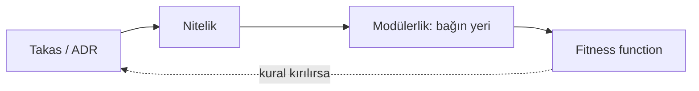

## Ders

### Bugün ne öğreneceksin?
Bugün yeni kavram öğrenmiyorsun; dört günün kavramlarını **tek bir zincire** dizip aralarındaki nedensellik bağını kuruyorsun. Gün sonunda haftanın tamamını dört cümlede anlatabilmen gerekir.

### Temel kavramlar
Haftanın zinciri şudur:

**yasalar (Gün 1) → nitelikler (Gün 2) → modülerlik (Gün 3) → fitness function'lar (Gün 4)**

Okunuşu — her ok bir "bu yüzden"dir:
- **Her şey bir takastır** (Gün 1), *bu yüzden* neyi kazanıp neyi feda ettiğini bilmen gerekir.
- Neyi kazandığını **nitelikler** söyler (Gün 2): elasticity mi, basitlik mi, güvenlik mi? Adlandırmazsan seçemezsin.
- Seçtiğin niteliği **modülerlik korunabilir kılar** (Gün 3): bağlar zayıf, az ve yakınsa değişiklik ucuzdur; güçlü, yaygın ve uzak bağ her niteliği zamanla yer.
- Ama insan dikkati kalıcı değildir; bu yüzden kuralı **fitness function** mekanik güvenceye alır (Gün 4) — Hafta 1'in "Sensor"ları ve Hafta 4'ün ArchUnit testleri ile aynı şey.

Zinciri tersten de okuyabilmelisin: *"Bu ArchUnit testi hangi bağı sabitliyor? O bağ hangi niteliği koruyor? O nitelik hangi takasın sonucuydu?"* Tersten okuma mimarlığın asıl sınavıdır — çünkü canlı bir kod tabanında sana verilen şey testtir, gerekçe değildir.

### Somut örnek (bu projeden)
Zincirin bu projedeki tam hâli, tek satırda:

`ADR-0004 (OpenRouter takası)` → `değiştirilebilirlik niteliği` → `LLM çağrısı yalnız ai/ paketinde (bağın yerelleştirilmesi)` → `claude_yalniz_ai_paketinden testi`

Dört halka da yerinde. Kavram haritanı çizerken bu satırı iskelet al ve kendi ürününden ikinci bir satır üret. Basit bir mermaid taslağı yeter:

Kesikli ok önemlidir: test kırmızı yandığında ilk gideceğin yer kod değil, **kararın kendisidir**. Ya kural hâlâ geçerlidir (kodu düzelt), ya bağlam değişmiştir (yeni ADR yaz). Üçüncü seçenek — "testi gevşet" — bu haftanın reddettiği şeydir.

### Sık yapılan hata
- **Haritayı sözlük gibi çizmek.** Kutulara terim yazıp okları boş bırakmak hiçbir şey öğretmez; değerli olan okların üstündeki "bu yüzden"lerdir.
- **Quiz'e ezberle girmek.** Sorular tanım değil, ayrım sorar: elasticity mi scalability mi, statik mi dinamik bağ. Terimi hatırlaman değil, **ikisini ayırabilmen** ölçülüyor.
- **Zinciri tek yönlü öğrenmek.** Yalnız soldan sağa okuyabiliyorsan gerçek kod tabanında kaybolursun.

### Görevlere geçmeden önce
Haritayı elle çizmen de yeter; mermaid kullanırsan repoda yaşar ve ajan da okuyabilir (Hafta 6, Gün 4'te bunun adını koyacağız). Quiz'i çözerken yanlış yaptığın soruyu **hangi güne ait olduğunu** yazarak not al: eksik gün, gelecek haftanın tekrar konusudur. Hafta 6 aynı zincirin üstüne kuruluyor — stil seçmek, bu haftanın diliyle, bir nitelik takasını seçmektir.

## Görevler
- [ ] 1 sayfalık kavram haritası çiz (elle/mermaid)
- [ ] Haftalık quiz'i çöz
