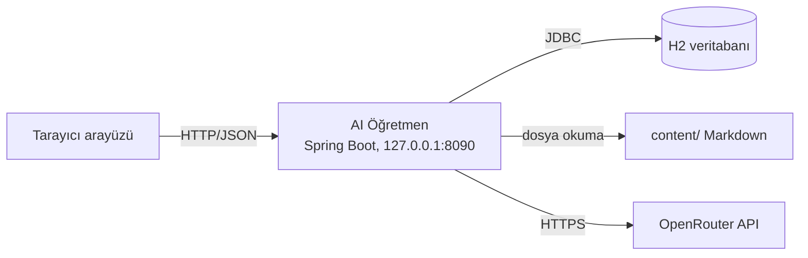

## Ders

### Bugün ne öğreneceksin?
Bugün dünkü diyagramı **repo bilgisine** çevireceksin. Aynı çizimin neden bir görsel araç dosyasında ölü, repoda metin olarak canlı olduğunu ve bunun ajanla çalışırken neyi değiştirdiğini öğreneceksin.

### Temel kavramlar
- **Metin-tabanlı diyagram (diagram as code):** Diyagramı sürükle-bırak ile değil, **kod gibi metin yazarak** üretmek. Mermaid'de `A -->|HTTP| B` yazarsın, araç oku çizer. Kaynak dosya düz metindir.
- **Ajan okunabilirliği (agent legibility):** Hafta 1 Gün 3'te öğrendiğin ilke — bilginin, ajanın **okuyabileceği** biçimde durması. Ajan `.drawio` veya `.png` dosyasının içini göremez; `.md` içindeki mermaid bloğunu **görür**.
- **Tek gerçek kaynağı (single source of truth):** Sistemin haritası tek bir yerde olmalı. Bu projede o yer `ARCHITECTURE.md`'dir; `AGENTS.md` ise oraya işaret eden içindekiler tablosudur.
- **Sürümlenebilirlik:** Metin diyagram git ile sürümlenir. Bunun asıl kazancı **diff**'tir: bir PR'da "şu ok eklendi" satır satır görülür. İkili (binary) bir görselde diff yoktur; inceleyen kişi iki resmi gözüyle karşılaştırmak zorundadır.

Bunun somut sonucu şudur: metin diyagram aynı anda **iki okuyucuya** hizmet eder — insana ve ajana. Görsel araca hapsolmuş diyagram ise yalnız o aracı açan kişiye hizmet eder, o da genelde onu çizen kişidir.

### Somut örnek (bu projeden)
`ARCHITECTURE.md` içine gömülen Container diyagramı şuna benzer:

Bu blok üç işi aynı anda yapar: (1) sayfada diyagram olarak render edilir, (2) git'te satır bazında sürümlenir, (3) ajanın bağlamına düz metin olarak girer. Ajana "sistemin mimarisini anlat" dediğinde cevabında `content/` deposunu ve OpenRouter okunu görüyorsan, haritayı **okumuştur**; yalnızca dosya adlarını sayıyorsa okumamıştır. Bugünün ikinci görevi tam olarak bu deneydir — ve bu, Hafta 5 Gün 4'ün diliyle bir **duman testidir**: haritanın işe yarayıp yaramadığını mekanik olarak sınarsın.

Bu, OpenAI'ın anlattığı "domain haritası + katman kuralı" pratiğinin genel hâlidir: ajanın işini kolaylaştıran şey daha uzun bir istem (prompt) değil, **repoda hazır duran doğru harita**dır.

### Sık yapılan hata
- **Diyagramı çizip repo dışında bırakmak.** Sunum dosyasındaki mimari, ne PR'da incelenir ne ajana ulaşır.
- **"Metin diyagram kendini günceller" sanmak.** Güncellemez. Kodla tutarlılığı yine insan sağlar; bu yüzden diyagramı **kodu değiştiren PR'ın içinde** güncelle — ayrı bir bakım işine bırakılan diyagram ölür.
- **Aynı diyagramı iki yerde tutmak.** İki kopya varsa biri yalandır ve hangisinin yalan olduğunu kimse bilmez.
- **Code seviyesini mermaid'e dökmek.** Dünkü kural burada da geçerli: sınıf seviyesi diyagram bakımı imkânsız bakım borcudur.
- **Ajan çıktısını "onaylamak" için soru sormak.** Deneyin amacı ajanı övmek değil; haritanın **eksik yerini** bulmaktır. Ajanın yanlış anlattığı kısım, senin diyagramında etiketsiz kalan oktur.

### Görevlere geçmeden önce
İlk görevde diyagramı olduğu gibi kopyalama; her oka **protokolü** yaz (dünkü kutu-ok tuzağı). İkinci görevde ajanın cevabını okurken şunu not al: hangi bilgiyi doğru, hangisini uydurdu? Uydurduğu her ayrıntı, haritada eksik olan bir satırın adresidir — düzelt ve deneyi tekrarla. Yarın (Gün 5) haftayı toparlayıp quiz'i çözeceksin.

## Görevler
- [ ] Container diyagramını mermaid'e çevirip ARCHITECTURE.md'ye göm
- [ ] Ajana 'sistemin mimarisini anlat' diye sor; diyagramı kullanıp kullanmadığını gözle
